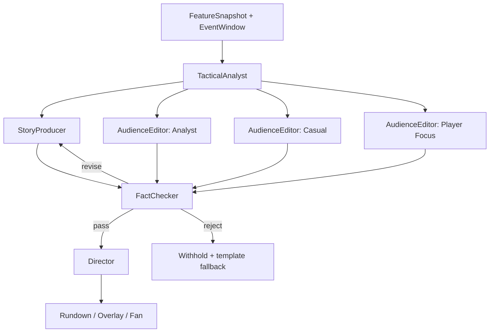
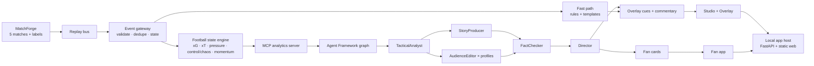

# MatchMind — Product & Architecture

> **Every moment, explained. Every fan, understood.**
>
> This document defines what MatchMind is and what “complete” means. It deliberately
> contains no dates, timeboxes, or delivery schedules. Work is driven by the
> completion gates in §10 and the build checklist in [EXECUTION.md](./EXECUTION.md).

---

## 1. Product

MatchMind is a real-time explainability layer for football broadcast. It turns a
synthetic match event stream into grounded, timed match intelligence and renders
it in three forms:

1. **Studio** — a broadcast control room for a director/producer: replay, agent
   rundown, evidence, approve/hold, program monitor.
2. **Overlay** — a transparent, broadcast-ready browser source (1920×1080) for
   lower-thirds, stat cards, momentum ribbons, pressure maps, and speed alerts.
3. **Fan** — a personalized second screen for analyst, casual, and player-focused
   audiences, in multiple languages.

The same event can produce three genuinely different experiences without
changing the underlying facts.

### 1.1 The problem

A match produces 1,200–1,500 events. Broadcasters have seconds to decide what
deserves airtime; fans get a scoreline. Existing tools report *what happened*,
not *why it mattered* — and one feed cannot serve an analyst, a casual fan, and a
player-focused viewer at the same time.

### 1.2 The core idea

- **Deterministic facts, probabilistic language.** All football numbers come from
  a deterministic engine. Models explain; they do not invent numbers.
- **Evidence-first.** Every displayed claim carries event IDs and metric
  references that can be opened in the UI.
- **Verification before air.** An independent FactChecker recomputes values and
  checks entailment. If evidence does not hold, the insight is withheld.
- **Fast path / slow path.** Scores, clock, possession, speed, and other urgent
  facts go on screen immediately; richer tactical explanations arrive within a
  few seconds or queue for the next stoppage.
- **One pipeline, many audiences.** Analyst, casual, and player-focused variants
  are generated from the same evidence bundle.

---

## 2. Closed loop (definition of “working”)

The local closed loop is complete when, from a clean checkout, this sequence
works without manually editing data:

1. Generate five synthetic matches with labels.
2. Start the app with one command.
3. Open **Studio**, select a match, and start replay.
4. See at least one **verified insight** with a headline, “why it matters”, and
   evidence chips.
5. Click a claim and see the supporting event IDs and metric calculation.
6. Approve the insight and see the **Overlay** update in a transparent browser
   source.
7. Open **Fan**, switch between Analyst / Casual / Player Focus and at least
   three languages; each variant is materially different.
8. Trigger or replay a **verifier rejection**: an unsupported claim is withheld
   instead of going on air.
9. Run the automated tests for data, analytics, verifier, and API contracts.

Public hosting and the demo video are deliverable packaging, not part of this
loop.

---

## 3. Five-stage pipeline

| Stage | What it does | Implementation |
|---|---|---|
| **Ingest** | Consume synthetic events and metadata as they happen | MatchForge JSONL → replay bus → EventGateway (validate, dedupe, state) |
| **Interpret** | Turn events into football states and metrics | Deterministic FootballStateEngine: xG, xT, pressure, pass quality, control/chaos, momentum, rhythm, speed/distance, ball/shot speed |
| **Explain** | Explain why a moment matters | TacticalAnalyst finds patterns → InsightCandidate with claims + evidence; FactChecker verifies |
| **Render** | Turn insight into timed on-screen content | StoryProducer → OverlayCue JSON → Studio program monitor + transparent overlay |
| **Personalize** | Same intelligence, different audiences | AudienceEditor: Analyst / Casual / Player Focus × language × club/player preferences |

**Invariant:** Interpret is deterministic. Explain is probabilistic. A model
never computes a number that is displayed as fact.

---

## 4. Studio

The operational surface for a director/producer.

- Match selector, clock, score, replay speed (1×/10×/60×), broadcast-safe toggle.
- Pitch view, event ticker, current possession.
- **Agent Rundown** with one card per insight:
  - headline, why it matters, evidence chips, confidence, suggested duration,
  - state: draft → verified → approved → on-air, or held/killed/withheld.
- **Evidence drawer**: event list, metric calculation, agent trace, verifier result.
- **Program monitor**: live preview of the overlay with safe-area guides.
- **Fan preview**: Analyst / Casual / Player Focus tabs and language switch.
- **Operational HUD**: fast-path p95, slow-path p95, model calls, cost estimate.

Actions: Approve, Hold, Kill, Regenerate. Broadcast-safe mode defaults to hold for
human approval; demo mode may auto-approve, but the controls remain.

---

## 5. Overlay

A transparent 1920×1080 browser source for OBS/vMix.

Components:

- Lower-third: player/team, key stat, two-line explanation.
- Stat card: xG, xT, pressure, pass difficulty, ball/shot speed.
- Momentum ribbon: recent 10-minute curve with change points.
- Pressure map: heat zone and number of pressers.
- Speed alert: sprint speed/distance when a threshold is crossed.
- “Why it matters”: what happened / why it matters.
- Control vs Chaos: live two-axis meter.

Rules:

- Driven by `OverlayCue` JSON: template, priority, in/out timestamps, payload,
  safe area.
- Queue and dedupe: no duplicate event within 60 seconds; at most one
  lower-third per 15 seconds; prefer stoppages.
- If an LLM times out, a deterministic template cue is used.
- If the verifier rejects a claim, nothing goes on air for that insight.
- Animations ≤ 400ms; no external font dependency; broadcast safe areas.

---

## 6. Fan

A mobile-first second screen.

Profiles:

- **Analyst** — numbers, tactical terms, pass network, xT/xG; 80–120 words.
- **Casual** — analogy, plain language, 30–50 words, no jargon; “what to watch
  next”.
- **Player Focus** — only events involving the selected player; speed, distance,
  touches, duels; comparison to match average.

Personalization inputs: favorite club, favorite player, language, expertise,
preferred metric, notification threshold, reading length.

Card structure:

1. What happened (fact)
2. Why it matters (explanation)
3. What to watch next (labeled as a forward-looking watch item, not fact)
4. How we know (expandable evidence; one line in casual mode)

A deterministic post-match recap adds the scoreline, goals, cards, key moments,
and top speed. It is composed from the same event stream and labels.

Languages: English, Spanish, Chinese, Arabic (RTL), Hindi. Language is not
word-for-word translation: number formats, football terminology, tone, and layout
adapt.

---

## 7. Multi-agent system

Five specialized agents coordinated by a Microsoft Agent Framework graph
workflow. The graph uses typed messages, shared state, explicit handoffs, and
checkpoints.

| Agent | Responsibility | Output | Failure behavior |
|---|---|---|---|
| **TacticalAnalyst** | Find patterns and explain why a moment matters; call analytics tools via MCP | `InsightCandidate` with claims, evidence, importance, confidence | Use cached feature snapshot; otherwise skip |
| **StoryProducer** | Write broadcast language and overlay specification; only use supplied evidence | `OverlayCue` + commentary line | Deterministic template cue |
| **AudienceEditor** | Rewrite the same insight for Analyst / Casual / Player Focus, in parallel | `FanCard` per profile/language | Other profiles continue; failed profile gets a template |
| **FactChecker** | Recompute numbers, verify event references, check entailment and safety | `VerificationResult` (pass / revise / reject) | Timeout = reject; withhold rather than guess |
| **Director** | Prioritize the rundown, manage airtime, dedupe, request human approval | `RundownDecision` | Deterministic priority queue |
| **RecapWriter** (optional) | Post-match recap with milestones | `MatchRecap` | Template recap |

### 7.1 Graph



### 7.2 Shared state

```text
MatchBlackboard
├─ match_state: score, clock, possession, formations
├─ feature_snapshot: xG, xT, pressure, control, chaos, momentum, rhythm
├─ event_window: recent events + selected key events
├─ insight_candidates: id, claims, evidence, importance, confidence
├─ used_claims: claim hash → timestamp (dedupe)
├─ fan_profiles: analyst / casual / player + language + club/player
├─ rundown: queued / approved / on-air / held / withheld
├─ budget: calls, tokens, cost, latency
└─ audit_log: agent, prompt version, tool calls, verification
```

### 7.3 Why five agents

- One prompt doing facts, narrative, translation, and review contradicts itself.
- A writer cannot reliably audit itself; the FactChecker can reject.
- Three audience variants are generated in parallel.
- Each agent has independent timeout, retry, and fallback.
- The Director can decide which moments deserve a strong model.
- Every step is traceable by agent, prompt version, model, and evidence.

### 7.4 Failure recovery

- Per-agent deadlines; timeouts produce typed fallback events.
- Retries with exponential backoff, max two attempts.
- Circuit breaker switches to deterministic templates and shows “degraded”.
- Verifier rejection: revise once, then withhold. Never downgrade to “probably
  right”.
- Model provider outage: cached insights and templates; fast path remains.
- Duplicate/conflicting claims: hash + event window dedupe; highest importance
  wins.
- Every decision is audited.

### 7.5 Model layer

- Default provider: DeepSeek via OpenAI-compatible API.
- `deepseek-flash` for routine generation and translation; `deepseek-v4-pro`
  for key tactical moments.
- Microsoft Agent Framework `OpenAIChatClient` with a custom `base_url`.
- Local MCP tools / function tools. Hosted MCP is not assumed.
- Structured output: JSON mode + Pydantic validation; one repair attempt.
- Provider adapter for Microsoft Foundry is optional and uses the same messages
  and schemas. The app must never claim Foundry/Azure usage unless it is actually
  deployed.

---

## 8. Data: MatchForge

Five deterministic synthetic matches with distinct narratives. Fictional clubs,
fictional players, no real match data or footage.

| Match | Fixture | Narrative | Key labels |
|---|---|---|---|
| 1 | Nova Harbor vs Orion North | The press trap: a line-breaking pass under pressure; 2–1 | 72' line break, 74' winner, 31' sprint peak |
| 2 | Vela Athletic vs Kepler Town | The comeback: 0–2 down to 3–2 with a late winner | 2nd/3rd goals, late winner, momentum shift |
| 3 | Orion North vs Vela Athletic | The red card: a tactical shift after a sending-off; 1–1 | red card, shape change, late equalizer |
| 4 | Kepler Town vs Nova Harbor | The press storm: high turnovers and a 0–2 away win | press trap, turnover chain, second goal |
| 5 | Nova Harbor vs Vela Athletic | The chaos game: 3–3 with momentum swings | opening goal, equalizer, late drama |

Each match has:

- `events.jsonl` — 1,100–1,500 events.
- `match.json` — teams, lineups, venue, final score, seed, generator version.
- `labels.json` — key moments with event IDs and expected claims, used only for
  evaluation. Labels are never fed to agents.

Event schema (factual record):

```json
{
  "match_id": "ast-2026-1018-nhr-orn",
  "event_id": "e-001011",
  "ts": "2026-10-18T16:12:09Z",
  "clock": {"period": 2, "minute": 72, "second": 9},
  "type": "pass",
  "team_id": "NHR",
  "player_id": "NHR-08",
  "location": {"x": 38.0, "y": 52.0},
  "end_location": {"x": 62.0, "y": 44.0},
  "recipient_id": "NHR-14",
  "pressure": 0.82,
  "outcome": "complete",
  "ball_speed_kmh": 18.4,
  "distance_m": 24.6,
  "difficulty": 8.7,
  "possession_id": "p-hero",
  "score": {"home": 1, "away": 1},
  "tags": ["line_break", "under_press", "hero"],
  "synth": {"seed": 20261018, "generator": "matchforge-v1"}
}
```

Realism checks (per match):

- 1,100–1,500 events; 78–88% pass completion; 8–18 shots per team; 0–6 goals;
  15–30 fouls; 1–7 cards; 40–60% possession; 0.8–2.5 xG per team; monotonic
  clock; explicit half-time and full-time events.

The generator is deterministic: seed + generator version reproduce the same
events. Labels are separate from events.

---

## 9. System architecture



- Single Docker image: FastAPI API, WebSocket, MCP route, static frontend.
- Local development: uvicorn on `:8010`; `:8000` is used by Caddy.
- Storage: SQLite/JSONL for audit; Cosmos adapter optional.
- Observability: OpenTelemetry spans + custom trace viewer; App Insights exporter
  optional.
- Production adapters: Foundry, Azure Container Apps, Bicep — optional, not
  required for the local closed loop.

---

## 10. Completion gates

These are capability gates, not time estimates.

### Gate 0 — Foundation (done)

- Repo, DeepSeek provider, Agent Framework smoke test, local API, MatchForge
  hero match, 7 passing tests.

### Gate 1 — Data completeness

- Five matches generated with the narratives in §8.
- Deterministic; all labels reference existing event IDs.
- Realism validation passes for every match.
- Dataset card and generation docs updated.

### Gate 2 — Analytics

- xG, xT, pressure, pass quality, control/chaos, momentum, rhythm, speed,
  distance, ball/shot speed implemented with versioned formulas.
- Evidence bundles for every metric.
- Unit tests with hand-computed fixtures.
- API endpoints for match state, features, and key moments.

### Gate 3 — Agents and verifier

- Five-agent graph runs end to end.
- InsightCandidate, OverlayCue, FanCard, VerificationResult contracts validated.
- Verifier rejects an unsupported claim and withholds it.
- Timeouts, retries, circuit breaker, and template fallbacks tested.
- Provider adapter supports DeepSeek; Foundry adapter optional.

### Gate 4 — Studio, Overlay, Fan

- Studio replay, rundown, evidence drawer, approve/hold/kill, program monitor.
- Transparent overlay with lower-third, stat card, momentum ribbon, pressure map,
  speed alert.
- Fan profiles and languages; material differences between profiles.
- End-to-end local run from a clean checkout.

### Gate 5 — Hardening

- Data, analytics, verifier, API contract, and UI smoke tests.
- Demo mode with no API key.
- Error states, empty states, reconnect, and degraded-mode UI.
- README with one-command setup and a 90-second judge path.
- Lint, type checks, and performance measurements.

### Gate 6 — Delivery packaging

- Public demo URL (tunnel, reverse proxy, or host).
- Two-minute demo video.
- Project description and testing instructions.
- Repository public, secrets excluded, licenses and data card included.

---

## 11. Non-goals

- Real match footage or CV auto-eventing.
- Real club/player data, crests, or likenesses.
- Full 22-player physics simulation.
- Native mobile app.
- Betting or prediction-market features.
- Claiming Azure/Foundry deployment without actually deploying it.

---

## 12. Demo narrative

The hero match is Nova Harbor vs Orion North, 1–1 in the 72nd minute.

1. Orion North push the line up and trigger a press trap.
2. Nova Harbor’s #8 plays a line-breaking pass under pressure to #14.
3. #14 sprints at 33.4 km/h; the pass adds 0.18 xT and removes three pressers.
4. The shot is saved; two minutes later Nova Harbor score the winner.
5. Studio shows the insight and evidence; the overlay goes on air.
6. Fan shows Analyst, Casual, and Player Focus versions in three languages.
7. A claim says “fastest sprint of the match”; the verifier finds that a 31'
   sprint was 33.8 km/h vs 33.4 km/h, so the claim is withheld.
8. The corrected insight goes on air.

The demo video is at most two minutes and shows the running product, not
mockups.
