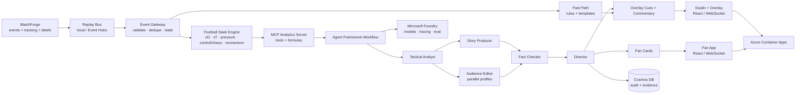
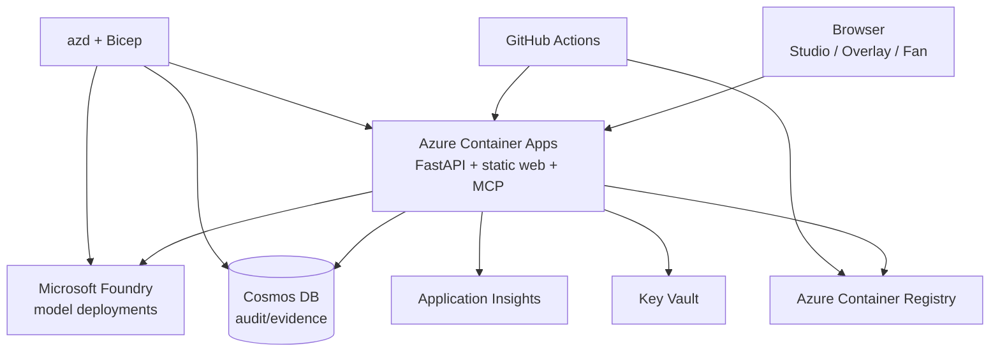
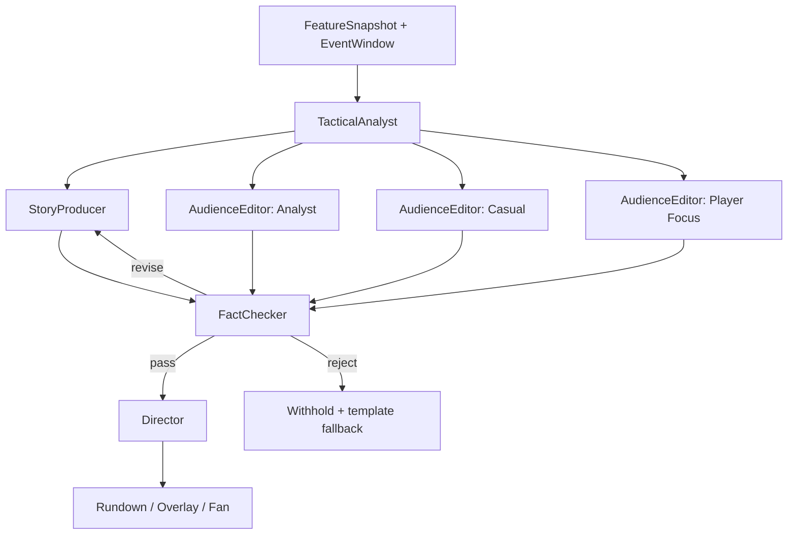

# MatchMind — Inside the Game 参赛规划（5.5 天冲刺版）

> 版本：2026-10-22 · 内部截止：2026-10-27 23:00 CST · 官方截止：2026-10-27 23:59 PT = 2026-10-28 14:59 CST
>
> 目标：Grand Prize: First Place + Best Multi-Agent System
>
> 官方规则：[OFFICIAL RULES.md](https://github.com/microsoft/insidethegamehackathon/blob/main/OFFICIAL%20RULES.md)

---

## 0. 先看结论

1. **做 MatchMind**：足球直播的实时“可解释比赛智能层”。
2. **一条管线，两个产品**：广播端 Director/Overlay + 观众端 Fan，共用一套事件流。
3. **五阶段全覆盖**：Ingest → Interpret → Explain → Render → Personalize。
4. **五个 agent**：TacticalAnalyst、StoryProducer、AudienceEditor、FactChecker、Director。
5. **技术主线**：Microsoft Foundry + Agent Framework + MCP + Azure Container Apps + Cosmos DB + App Insights。
6. **数据自建**：MatchForge 合成数据，虚构球队/球员，5 场，带 ground truth。
7. **主打奖项**：Grand Prize；类别主攻 Best Multi-Agent System。
8. **最大风险**：按官方规则，报名已在 10/20 12:00 PT 截止。今天第一件事是确认报名；没报名就立刻联系主办方。
9. **今天必须打通**：报名、Foundry 模型、repo 骨架、1 场合成数据、hello-world 部署。
10. **如果只有 25-30 小时**：走 §11.3 的 Minimum scope，保 overlay + 双观众 + verifier + 2 分钟视频。

---

## 1. 硬约束与时间线

### 1.1 时间

| 节点 | 官方时间 | 北京时间 | 说明 |
|---|---|---|---|
| 报名 | 2026-09-29 09:00 PT – 2026-10-20 12:00 PT | 09-30 00:00 – 10-21 03:00 | **按规则已截止**；未报名需立刻联系主办方 |
| 提交 | 2026-10-06 09:00 PT – 2026-10-27 23:59 PT | 10-07 00:00 – **10-28 14:59** | 剩余约 5 天 16 小时 |
| 评审 | 2026-10-27 09:00 PT – 2026-11-10 23:59 PT | 10-28 00:00 – 11-11 15:59 | 评委可能只看视频/描述 |
| 公布 | 不晚于 2026-11-20 23:59 PT | 2026-11-21 15:59 | — |

**内部截止：2026-10-27 23:00 CST**（比官方截止早约 16 小时）。10-28 上午只做链接复核和应急提交，不加功能。

### 1.2 参赛硬性要求

| 要求 | 对我们的影响 |
|---|---|
| 团队 ≤ 4 人，指定 1 名 Representative | 单人也可以；团队需明确提交人 |
| 项目必须是 2026-09-29 之后新建 | 当前 repo 为空，符合 |
| 公开 GitHub repo | 当前 remote 是 `ruziniuuuuu/matchmind`，提交前确认 public |
| 2 分钟以内 demo 视频，公网 URL | 必须提前录；不能超 2:00 |
| 英文材料（或提供英文翻译） | 代码/README/视频/描述都用英文 |
| 合成、足球真实感数据；无真实比赛画面/数据 | 自建 MatchForge；不用 StatsBomb/真实俱乐部 IP |
| 可免费访问的 demo（评委测试到评审结束） | 提供公网 URL + 无 key 的 demo mode |
| 不能是其他比赛获奖作品；原创 | 全新代码；开源依赖合规 |
| 每个项目最多 1 个 Grand + 1 个 Category | 主打 Grand + Multi-Agent |

### 1.3 奖项（按官方规则）

| 奖项 | 每人奖励（摘要） |
|---|---|
| Grand Prize 1st | $4,000 + $1,000 球票 + $50 商店券 |
| Grand Prize 2nd | $2,500 + $1,000 球票 + $50 商店券 |
| Category（4 个） | $1,500 + $50 商店券 |

> 中国不在规则明确排除的国家名单内；但税务、外汇、当地法律需自行确认。这不是法律意见。

### 1.4 报名是 gate

按规则，报名在 10/20 12:00 PT 已截止。今天（10/22）必须做三件事：

1. 打开 [aka.ms/insidethegame](https://aka.ms/insidethegame)，尝试 Register；截图保留。
2. 如果已关闭，立刻通过活动页 / Microsoft Reactor 系列页的 contact 渠道说明情况，询问是否可补录；同时发邮件给活动联系人（如页面有）。
3. 不要等确认才开始写代码；但**不要在没有报名确认的情况下投入完整 5 天**。先做 3-4 小时的垂直切片，确认能参赛后再加码。

Reactor 系列页：[Inside the Game: Developer Hackathon](https://developer.microsoft.com/en-us/reactor/series/S-1709/)。

---

## 2. 项目定位

### 2.1 一句话

**MatchMind 是足球直播的实时“可解释比赛智能层”**：把合成比赛事件流变成有证据链、可按观众画像改写、可直接叠加到直播画面上的洞察。

**Tagline**：*Every moment, explained. Every fan, understood.*

### 2.2 电梯演讲（英文，可直接用于提交）

> MatchMind is a real-time explainability layer for football broadcast. It ingests synthetic match events, computes the football state deterministically, and uses a team of specialized agents to explain why each moment matters — with an evidence trail. The same insight is rendered as a broadcast-ready overlay for the studio and as a personalized second-screen experience for analysts, casual fans, and player-focused viewers in multiple languages. Every claim is verified before it goes on air.

### 2.3 问题

- 一场 90 分钟比赛产生约 1,200-1,500 个事件；导播只有几秒钟决定“这条信息值不值得上屏”。
- 现有数据产品回答“发生了什么”（控球率、射门数），很少回答“为什么重要”（press trap、line break、momentum shift）。
- 同一场比赛，分析师要深度，casual fan 要人话，球员粉要个人视角；一条通稿无法同时满足。
- LLM 直接写解说会编数字；广播场景对事实错误零容忍。
- 多语言/多市场通常是事后翻译，而不是从叙事层就为本地观众生成。

### 2.4 解决方案

一条五阶段管线：

1. **Ingest**：MatchForge 合成事件 + 追踪数据，按比赛时钟实时回放。
2. **Interpret**：确定性引擎计算 xG、xT、pressure、pass quality（距离/准确率/难度）、control/chaos、momentum、rhythm、player speed/distance、ball/shot speed。
3. **Explain**：TacticalAnalyst 找模式，StoryProducer 写“上屏语言”，FactChecker 逐条核对证据。
4. **Render**：OverlayCue JSON → 广播级 lower-third / stat card / momentum ribbon，同步到比赛时钟。
5. **Personalize**：AudienceEditor 按 Analyst / Casual / Player Focus + 语言 + 主队/球员改写。

### 2.5 为什么不是聊天机器人

聊天机器人是“用户来问”，广播是“系统在正确的时间推”。MatchMind 的核心是**定时、可排队、可审核、可降级的上屏管线**，不是对话框。这个区别会在 demo 和架构里反复体现。

### 2.6 目标用户与价值

| 用户 | 痛点 | MatchMind 的价值 |
|---|---|---|
| 广播制作人/导播 | 信息过载、上屏节奏难控、怕说错 | 自动 rundown + 证据 + 一键 approve/hold |
| 解说/评论员 | 需要“为什么”的谈资 | 2-4 秒内给出战术解释 + 可引用数据 |
| 流媒体平台 | 全球市场、多语言、成本 | 一套事件流，多语言/多画像输出 |
| 分析师 | 数据深但叙事弱 | 证据链 + 战术模式 + 可导出 |
| 球迷 | 看不懂战术、想要主队/球员视角 | 人话解释 + 个性化 + 球员聚焦 |
| 低级别联赛/区域转播 | 请不起完整制作团队 | 低成本自动化 overlay + 解说 |

### 2.7 为什么现在

- 多模态/推理模型 + agent orchestration 已经能把“事件 → 战术解释 → 上屏文案”做成实时管线。
- 广播正在从“人工图形”转向“数据驱动、自动化、个性化”的 second screen。
- Microsoft Foundry + Agent Framework 提供了托管模型、工具、追踪、评估和一整套企业治理能力，适合做“可上生产的 demo”。

---

## 3. 为什么这个方案能赢

### 3.1 评分标准映射

| 评分项 | 权重 | 评委想看什么 | MatchMind 的证据 |
|---|---:|---|---|
| Technological Implementation | 20% | 合成数据创意、工程质量、Microsoft 技术栈、代码可维护 | MatchForge + 确定性引擎 + MCP + Agent Framework + 测试 + IaC + 可观测性 |
| Agentic Design & Innovation | 20% | agentic 模式、编排/MCP/多 agent、novelty | 5 个角色 agent、graph workflow、共享黑板、verifier loop、fallback、trace |
| Real-World Impact | 20% | 问题重要性、可生产、影响 | 广播/流媒体真实工作流；延迟/成本；企业治理；多语言市场 |
| UX & Presentation | 20% | 体验、视频、前后端平衡 | Studio + Overlay + Fan 三端；2 分钟双屏 demo；广播级视觉 |
| Adherence to Category | 20% | 是否符合类别 | 明确主攻 Best Multi-Agent System；同时展示 Foundry/Azure |

### 3.2 五个“评委记得住”的点

1. **Evidence-first**：每个数字都能点开看到事件 ID 和计算公式。
2. **Verifier catches a lie**：demo 里故意让 FactChecker 抓一次错误，然后 withhold；这比“我们很准”有说服力。
3. **Same moment, three ways**：同一次进攻，Analyst/Casual/Player Focus 三种文案 + 三种语言同屏对比。
4. **Fast path / slow path**：200ms 上屏的比分/速度，2-4 秒的深度解释；广播场景的真实工程取舍。
5. **Control vs Chaos**：把规则点名的概念做成实时双轴可视化，而不是 prompt 里的形容词。

### 3.3 备选方向（为什么不选）

| 方向 | 问题 |
|---|---|
| 比赛问答 chatbot | 太同质化；不覆盖 Render/Personalize；难以证明实时性 |
| 自动高光剪辑 | 需要视频/版权；5 天做不好 CV；违反“无真实画面”风险 |
| 纯战术数据面板 | 没有个性化、没有叙事、没有 agentic 故事 |
| 竞猜/投注洞察 | 规则不允许负面内容；企业风险高 |
| 裁判辅助 | 偏离“fan experience/broadcast”主题；数据难合成 |

---

## 4. 产品形态

### 4.1 Director Mode（B 端，Studio）

**目标**：让导播/制片在直播中“敢用、可控、可审计”。

- 顶部：比赛选择、时钟、比分、回放速度（1x/10x/60x）、Broadcast-safe 开关。
- **Broadcast-safe**：只允许已核实事实 + 中性措辞；禁止投注、党派/人身攻击、未经证实的猜测；strict mode 默认 hold，等人 approve。
- 左栏：球场俯视图 + 事件 ticker + 当前 possession。
- 中栏：Program monitor（当前 overlay 预览）+ 安全区参考线。
- 右栏：**Agent Rundown**
  - 每条 `RundownItem`：headline、why it matters、evidence chips、confidence、建议时长、优先级、状态（draft/verified/approved/on-air/held/killed）。
  - 操作：Approve / Hold / Kill / Regenerate。
  - 证据抽屉：事件列表、指标计算、agent trace、verifier 结果。
- 底部：Fan preview tabs（Analyst / Casual / Player Focus）+ 语言切换。
- HUD：fast path p95、LLM p95、每条洞察成本、当前模型。

**关键交互**：点击任意 insight → 右侧证据抽屉；点击 “Why?” → 显示 claim → evidence 映射；点击 “Trace” → 显示 agent 调用链。

### 4.2 Overlay（广播画面）

**目标**：OBS/vMix 直接可用的 1920×1080 透明 browser source。

组件：

- **Lower-third**：球员名/球队、关键数据、2 行解释。
- **Stat card**：xG/xT/pressure/pass difficulty/ball speed/shot speed，带 mini bar。
- **Momentum ribbon**：最近 10 分钟动量曲线 + change point。
- **Pressure map**：球场热区 + 压迫人数。
- **Speed alert**：球员冲刺速度/距离，超过阈值触发。
- **Why it matters**：两行“发生了什么 / 为什么重要”。
- **Control vs Chaos**：双轴 meter，实时更新。

技术要求：

- 透明背景、广播安全区、可配置主题（队色）、动画 ≤ 400ms、无外部字体依赖（或本地字体）。
- 由 `OverlayCue` JSON 驱动：`{id, template, priority, in_at, out_at, payload, safe_area}`。
- 队列/去重：同一事件 60 秒内不重复；每 15 秒最多 1 条 lower-third；直播死球时优先。
- 失败降级：LLM 超时 → 模板 cue；verifier 拒绝 → 不上屏。

### 4.3 Fan Mode（C 端）

**目标**：同一事件，不同的人看到不同的“为什么”。

三种 profile：

- **Analyst**：数字、战术术语、pass network、xT/xG、80-120 词。
- **Casual**：类比、人话、30-50 词、无 jargon；“What to watch next”。
- **Player Focus**：只显示我的球员相关事件；速度/距离/触球/对抗；与全场平均对比。

个性化维度：

- 主队、最爱球员、语言（EN/ES/ZH/AR/HI）、专业度、最关心的指标、通知阈值、阅读长度。
- 语言不是逐字翻译：数字格式、足球术语、语气、RTL 布局都要适配。

卡片结构：

1. **What happened**（事实）
2. **Why it matters**（解释）
3. **What to watch next**（前瞻，标注为 “watch for”，不是事实）
4. **How we know**（可展开证据；casual 版一句话）

### 4.4 Hero Moment（demo 的垂直切片）

**虚构比赛**：Nova Harbor vs Orion North，第 72 分钟，1-1。

- Orion North 把防线推高，触发 press trap。
- Nova Harbor 的 #8 在压力下送出一脚 line-breaking pass，找到 #14 的跑动。
- xT 从 0.08 跳到 0.26；pass difficulty 8.7/10；#14 冲刺 33.4 km/h。
- 3 秒后射门，xG 0.21；2 分钟后进球。
- 同一时刻：
  - Analyst：press structure、pass lane、xT delta、space behind。
  - Casual：“Orion North 压上 5 个人，一脚传球把整条防线甩在身后。”
  - Player Focus：#14 的 sprint、run angle、distance covered。
  - 语言：EN/ES/ZH（AR 可选）。
- FactChecker 抓一个错误：文案说“全场最快冲刺”，证据显示是第二快；改写或 withhold。

这个 moment 是视频的核心，D0 就把它跑通。

### 4.5 视觉方向

- 广播深色底：`#070B14` / `#0E1526`；主色 electric lime `#C9FF3D`；辅助 cyan `#38D9FF`；警示 coral `#FF5C5C`。
- 字体：Inter / IBM Plex Sans + tabular numerals；标题可用较窄的 grotesk。
- 数据可视化：SVG 球场、pass arrow、pressure heatmap、momentum ribbon；避免 3D/拟物。
- 动效：上屏 250-400ms ease-out；数字滚动；不炫技。
- 品牌：MatchMind monogram；**不使用 Premier League 或真实俱乐部 logo/crest/球员照片**。
- 可访问性：WCAG AA、键盘操作、captions、reduced motion、RTL。

### 4.6 明确不做

- 不做真实比赛视频/CV auto-eventing（5 天不够，且版权风险）。
- 不做真实俱乐部/球员数据。
- 不做完整 22 人物理引擎；做“事件级 + 关键窗口追踪”的可信模拟。
- 不做 native mobile app；Fan 用 responsive web。
- 不做投注/竞猜。
- 不做 TTS/数字人（可选 stretch，但不进 critical path）。

---

## 5. 五阶段 Pipeline

| Stage | 规则要求 | MatchMind 实现 | 可验证证据 |
|---|---|---|---|
| **Ingest** | 实时摄入 pass/shot/tackle/possession/pressure/metadata | MatchForge 生成 JSONL；ReplayBus 按比赛时钟推送；EventGateway 校验/去重/更新状态；可选 Event Hubs adapter | 事件延迟 <10ms；schema 校验；replay 可复现 |
| **Interpret** | 转成有意义统计/模式/上下文 | FootballStateEngine：xG、xT、pressure、pass quality（距离/准确率/难度）、control/chaos、momentum、rhythm、player speed/distance、ball/shot speed；版本化公式 | 单元测试 + 手算 fixture；分布校验 |
| **Explain** | 解释“为什么重要”，不只是“发生了什么” | TacticalAnalyst 找模式 → InsightCandidate（claims + evidence + confidence）→ FactChecker 核对 | 每条 claim 有 event_ids/metric_refs；verifier 通过率 |
| **Render** | 变成可上屏、可同步的内容 | StoryProducer → OverlayCue（template/payload/timing/priority）→ React overlay + Studio program monitor | OBS 透明源可用；上屏 p95 |
| **Personalize** | 同一智能，不同观众体验 | AudienceEditor：Analyst/Casual/Player Focus × 语言 × 主队/球员；FanCard | 同事件三种文案；语言质量评估 |

**关键设计**：Interpret 是确定性的，Explain 才是概率性的。LLM 不允许自己算数字；所有数字来自引擎/工具。

---

## 6. 系统架构

### 6.1 总览



### 6.2 组件职责

| 组件 | 职责 | 技术 |
|---|---|---|
| MatchForge | 生成比赛事件、追踪、标签、lineups | Python + Pydantic + NumPy |
| ReplayBus | 按比赛时钟/倍速推送；支持 pause/seek | asyncio；本地 / Event Hubs adapter |
| EventGateway | 校验、去重、排序、更新 MatchState | FastAPI + Pydantic |
| FootballStateEngine | 滚动窗口特征、指标、模式检测 | Python；纯函数；版本化公式 |
| MCP Analytics Server | 把引擎能力暴露为工具给 agent | FastMCP / HTTP |
| Agent Workflow | 5 个 agent 的 graph 编排、共享状态、重试 | Microsoft Agent Framework |
| Model Layer | chat + structured output；模型路由 | Microsoft Foundry |
| OverlayComposer | cue → React overlay；队列/去重/超时 | TypeScript + React |
| Studio | 导播工作台、rundown、证据、审批 | React + Vite + Tailwind |
| Fan App | 个性化卡片、语言、球员聚焦 | React + Vite |
| AuditStore | 证据、决策、verifier 结果 | Cosmos DB serverless（本地 SQLite） |
| Observability | trace、latency、token、cost | OpenTelemetry + App Insights |
| Infra | 一键部署 | Bicep + azd + Container Apps |

### 6.3 数据流与延迟预算

```text
MatchForge → ReplayBus → EventGateway → State/Features
                                      ├─ FastPath (rules/templates) → OverlayCue → WS → Overlay
                                      └─ SlowPath (agents) → Insight → Verifier → Director → Overlay/Fan
```

| 阶段 | Fast path | Slow path |
|---|---:|---:|
| ingest + state | 30ms | 30ms |
| 规则/模板 | 20ms | — |
| 工具调用 | — | 200-400ms |
| TacticalAnalyst | — | 1.5-2.5s |
| StoryProducer | — | 0.8-1.2s |
| AudienceEditor（并行） | — | 0.8-1.5s |
| FactChecker | — | 0.5-0.8s |
| Director | 5ms | 100-300ms |
| 推送/渲染 | 50ms | 50ms |
| **p95** | **< 250ms** | **< 5s** |

**策略**：

- 比分/时钟/控球/速度等 fast path 直接模板上屏，不等 LLM；模板只使用引擎计算的数字，仍然写入 audit，可追溯。
- 深度解释 slow path 有 15-25 秒的“可上屏窗口”；超时则排队到下一个死球，或只更新 Fan 卡片。
- 同一事件窗口合并（debounce 1.5-2s），避免每个 pass 都调 LLM。
- 模型路由：常规文案用小模型；关键 moment 用强模型；翻译/改写用小模型。
- 缓存：按 `event_window_hash + profile + lang + prompt_version` 缓存；demo 模式直接读缓存。

### 6.4 部署拓扑



- 单容器：FastAPI 提供 API、WebSocket、MCP route、静态前端；减少部署面。
- Container Apps：scale-to-zero（demo 成本低），min replicas 0/1；WebSocket 支持。注意 ingress idle timeout，前端加 keepalive + 自动重连。
- Managed Identity 访问 Foundry / Cosmos / Key Vault；不把 key 写进代码。
- `azd up` 一键；`.env.example` 本地开发。
- Foundry 可选：把 orchestrator 部署为 **hosted agent**，BFF 调 managed endpoint；如果时间/region 不允许，保持 in-process，代码用 adapter 隔离。

### 6.5 Demo mode（评委可测试）

- `DEMO_MODE=replay`：读预生成的 insights/cues，不需要 Azure key。
- `DEMO_MODE=live`：调用 Foundry；需要环境变量。
- 公网 URL 默认 demo mode；README 提供“90 秒评委路径”。
- 所有 demo 数据固定 seed，刷新可复现。

---

## 7. 多智能体设计

### 7.1 Agent 角色

| Agent | 角色 | 输入 | 工具 | 输出 | 失败/降级 |
|---|---|---|---|---|---|
| **TacticalAnalyst** | 找战术模式、解释为什么 | FeatureSnapshot + event window + question | MCP: get_state, get_window, pressure_map, pass_network, detect_patterns, player_metrics | `InsightCandidate`（claims/evidence/importance/confidence） | 工具失败 → 用缓存快照；仍失败 → 跳过 |
| **StoryProducer** | 写广播语言 + overlay spec | candidate + tone + duration + brand | 无（只读 evidence） | `OverlayCue` + `CommentaryLine` | 超时 → 模板 cue |
| **AudienceEditor** | 按画像/语言改写 | candidate + profile + lang | 术语表、风格指南 | `FanCard` | 单 profile 失败 → 其他继续；失败 profile 用模板 |
| **FactChecker** | 逐条核对数字/引用/措辞 | candidate/cue + evidence bundle | 重算工具、entailment judge、安全规则 | `VerificationResult`（pass/revise/reject） | 超时 → reject（宁可不发） |
| **Director** | 排优先级、控节奏、审批（人保留最终 approve 权） | verified items + rundown + budget | 队列/去重/时间窗 | `RundownDecision` | 失败 → 确定性优先队列 |
| **RecapWriter**（可选） | 赛后 recap + milestones | 全场 timeline + key moments + milestones | 同 evidence | `MatchRecap` | 失败 → 模板 recap |

### 7.2 编排图



- 用 **graph workflow**，不用自由群聊；每条边有类型和条件。
- TacticalAnalyst 之后 fan-out 到 Producer 和 3 个 AudienceEditor；fan-in 到 FactChecker。
- FactChecker 的 revise 回到对应 writer（Producer 或 AudienceEditor），最多 2 次；仍失败则 reject + withhold。
- Director agent 是 human-in-the-loop 的前一步；strict mode 需要人 approve。demo 可 auto-approve，但 UI 始终保留 approve/hold。

### 7.3 共享状态（MatchBlackboard）

```text
MatchBlackboard
├─ match_state: score, clock, possession, formations
├─ feature_snapshot: xG/xT/pressure/control/chaos/momentum/rhythm
├─ event_window: last N events + selected key events
├─ insight_candidates: id, claims, evidence, importance, confidence
├─ used_claims: hash → timestamp (dedupe)
├─ fan_profiles: analyst/casual/player + lang + club/player
├─ rundown: queued/approved/on-air/held
├─ budget: tokens, cost, latency, remaining
└─ audit_log: agent, prompt_version, tool_calls, verification
```

- 状态按 match_id 隔离；每个 workflow run 有 checkpoint。
- Agent 不直接改全局状态；通过 typed message 返回，由 workflow 合并。
- 所有 claim 带 `evidence_event_ids` + `metric_refs`；没有证据的 claim 不允许进入 Producer。

### 7.4 为什么是 multi-agent，而不是一个 agent

| 单 agent 的问题 | 多 agent 的解法 |
|---|---|
| 一个 prompt 同时做事实、叙事、翻译、审核，容易自相矛盾 | 角色分离：Analyst 只解释，Producer 只写，Editor 只改写，Checker 只核对 |
| 自己写自己审，等于没审 | 独立 FactChecker + 重算工具；reject 能否决 |
| 3 个观众画像串行生成，延迟高 | AudienceEditor 并行 fan-out |
| 一个模型调用失败，整条管线挂 | 每个 agent 独立超时/重试/降级 |
| 成本不可控 | Director 按 importance/budget 决定是否调用强模型 |
| 难以定位错误 | 每个 agent/tool 有 trace + prompt version |

### 7.5 失败恢复（评委一定会问）

- **超时**：每个 agent 有 deadline；超时返回 `Timeout`，workflow 走 fallback。
- **重试**：工具/模型 transient error 指数退避，最多 2 次；幂等。
- **熔断**：连续失败打开 circuit breaker，直接模板模式；UI 显示 degraded。
- **verifier reject**：改写一次；仍失败则 `withheld`，UI 显示 “insufficient evidence”，绝不降级成“大概正确”。
- **模型/Foundry 不可用**：demo cache + 模板；保留 fast path。
- **重复/冲突**：claim hash + event window 去重；同一事件只保留最高 importance。
- **审计**：每次决策记录 agent、prompt_version、model、tokens、latency、evidence。

### 7.6 Foundry 相关实现

- `FoundryChatClient` + `Agent`（Python Agent Framework）。
- 模型部署在 Foundry project；用 deployment name，不硬编码 model。
- Structured output 用 Pydantic schema + JSON schema；失败则 repair 一次。
- Foundry tracing / App Insights：每个 agent/tool 一个 span；UI 可跳转 trace。
- Foundry evaluation（可选）：groundedness / coherence；自定义 verifier 为主。
- 可选 hosted agent：把 workflow 容器化，部署到 Foundry Agent Service；BFF 通过 managed endpoint 调用。**这是 stretch，不是 critical path**。

---

## 8. 合成数据：MatchForge

### 8.1 目标

- 没有官方数据包；自建**合成、足球真实感**的数据集，既是参赛必需，也是 “Data Innovation” 的评分点。
- 数据要能支撑：pass/shot/tackle/pressure/possession、speed/distance、key moments、ground truth。
- 完全虚构球队/球员/联赛；不使用真实比赛画面、数据、logo、球员肖像。

### 8.2 生成模型

**事件级模拟 + 关键窗口追踪**，不做完整 22 人物理引擎。

- 球队战术 profile：press intensity、line height、width、tempo、directness、transition bias、set-piece strength。
- Possession loop：按区域/压力/比分/体能选择 pass/carry/dribble/shot/tackle/foul；更新坐标与 possession。
- 事件类型：kickoff、pass、carry、dribble、tackle、pressure、interception、clearance、shot、goal、foul、card、offside、corner、substitution、half-time、full-time。
- 关键 beat 脚本：`beats.yaml` 指定分钟、球队、球员、结果、期望标签；用于 hero match。
- 球速/射门速度：由相邻事件坐标与时间差计算 ball speed；shot event 记录 `shot_speed_kmh`。
- milestones：球员触球/传球/射门里程碑、球队连续传球、逆转/绝杀等；由规则检测，供叙事使用。
- 追踪：1Hz 全场 + 关键窗口 5Hz；速度/距离/冲刺从追踪积分。
- 输出：`match.json`、`events.jsonl`、`tracking.jsonl`、`labels.json`、`lineups.json`、`match_card.md`。

### 8.3 真实性校验

| 指标 | 目标范围 |
|---|---|
| 事件数/场 | 1,100-1,500 |
| 传球成功率 | 78-88% |
| 射门数/队 | 8-18 |
| 进球数/场 | 0-5 |
| 犯规数/场 | 18-28 |
| 黄牌/场 | 2-6 |
| 控球率 | 40-60% |
| xG/队 | 0.8-2.5 |
| 冲刺次数/队 | 80-140 |
| 最高速度 | 30-35 km/h |
| 球速（传球） | 8-30 km/h |
| 射门速度 | 60-120 km/h |

`pytest` + `make validate-data` 失败则阻断生成。分布图存入 `docs/data-card.md`。

### 8.4 Schema（事件）

```json
{
  "match_id": "ast-2026-1018-nhr-orn",
  "event_id": "e-000842",
  "ts": "2026-10-18T15:42:11.240Z",
  "clock": {"period": 2, "minute": 72, "second": 14},
  "type": "pass",
  "team_id": "NHR",
  "player_id": "NHR-08",
  "location": {"x": 38.2, "y": 51.7},
  "end_location": {"x": 61.9, "y": 44.1},
  "recipient_id": "NHR-14",
  "pressure": 0.82,
  "outcome": "complete",
  "ball_speed_kmh": 18.4,
  "possession_id": "p-0312",
  "score": {"home": 1, "away": 1},
  "synth": {"seed": 20261018, "generator": "matchforge-v1"}
}
```

- 坐标：0-100 归一化；文档写清方向。
- `pressure`：0-1；由最近对手距离、封闭速度、持球时间合成。
- 事件只描述事实；不包含“重要/精彩”标签（避免泄漏）。

### 8.5 Labels（只用于评估）

```json
{
  "match_id": "ast-2026-1018-nhr-orn",
  "moment_id": "m-072-01",
  "clock": {"minute": 72, "second": 14},
  "type": "line_break_under_press",
  "importance": 0.92,
  "event_ids": ["e-000842", "e-000843", "e-000844"],
  "expected_claims": ["3 players bypassed", "xT +0.18", "space behind right back"],
  "notes": "Hero moment for demo"
}
```

- Labels 不进入 agent prompt；只在 eval 里对比。
- 评估集和 demo 集分开，避免过拟合。

### 8.6 虚构实体

| 球队 | ID | 颜色 | 主场 |
|---|---|---|---|
| Nova Harbor | NHR | teal/navy | Meridian Park |
| Orion North | ORN | red/white | Orion Park |
| Vela Athletic | VEL | blue/yellow | Vela Ground |
| Kepler Town | KEP | gold/black | Kepler Arena |

- 联赛：Aster League（虚构）。
- 球员名：完全虚构；避免与真实球员重名（人工检查 + blocklist）。
- 不使用真实俱乐部 crest/kit 设计；用简单几何图形。
- 提交前做一次名称/商标检索；若与真实俱乐部重名，改用更独特的虚构名。

### 8.7 数据资产

- 5 场：3 场 demo（`data/demo/`，含 hero match）+ 2 场 held-out eval（`data/eval/`）。
- `data/dataset-card.md`：来源、生成方法、schema、许可（CC BY 4.0）、限制。
- `data/README.md`：如何生成、如何校验、如何引用。
- 代码 MIT；数据 CC BY 4.0；依赖 license 检查。

---

## 9. 技术栈与 Azure 资源

### 9.1 技术栈

| 层 | 选择 | 理由 |
|---|---|---|
| Frontend | Vite + React 19 + TypeScript + Tailwind + shadcn/ui | 快、轻、无 SSR；overlay 透明源简单 |
| Charts | visx / Recharts + 自绘 SVG pitch | 可控、广播风格 |
| Backend | Python 3.12 + FastAPI + Pydantic v2 + uv | 与 Agent Framework/数据栈一致 |
| Agents | Microsoft Agent Framework (Python) | graph workflow、状态、MCP、telemetry |
| Models | Microsoft Foundry deployments（小模型 + 强模型路由） | 托管、追踪、评估、企业治理 |
| MCP | FastMCP / HTTP MCP server | 工具复用；评委可见 |
| Data local | JSONL + DuckDB/SQLite | 零依赖、快 |
| Data cloud | Cosmos DB serverless（audit/evidence） | 云原生、按量 |
| Realtime | WebSocket（FastAPI） | 简单、低延迟；Event Hubs adapter 可选 |
| Deploy | Azure Container Apps + ACR + Key Vault + App Insights | scale-to-zero、managed identity |
| IaC | Bicep + azd | 一键、可复现 |
| CI | GitHub Actions | lint/test/build/deploy |
| Observability | OpenTelemetry + App Insights | agent/tool spans、latency、cost |
| Dev | GitHub Copilot Agent Mode + `.github/copilot-instructions.md` | 提高速度；可写入 “how we built” |

### 9.2 Azure 资源清单

| 资源 | 用途 | 必须? |
|---|---|---|
| Foundry account + project + model deployments | 模型、tracing、eval | 必须 |
| Container Apps environment + app | API + web + MCP | 必须 |
| Azure Container Registry | 镜像 | 必须 |
| Log Analytics + App Insights | 可观测性 | 必须 |
| Key Vault + Managed Identity | 密钥/身份 | 必须 |
| Cosmos DB serverless | audit/evidence | 应该 |
| Event Hubs | 真实事件接入 adapter | 可选 |
| Azure Static Web Apps | 前端分离部署 | 可选（不必要） |
| Azure AI Speech | TTS 解说 | 不做（stretch） |

### 9.3 成本控制

- Container Apps scale-to-zero；demo 时 min=0，录制时 min=1。
- 小模型做 routine；强模型只给 key moments；缓存。
- Cosmos serverless；App Insights 采样。
- 预算警报 $50；每日检查。
- 预计 5 天 $20-50（不含已有 credits）。

### 9.4 Repo 结构

```text
matchmind/
├─ src/matchmind/
│  ├─ api/              # FastAPI, WebSocket, static
│  ├─ analytics/        # metrics, patterns, versioned formulas
│  ├─ agents/           # workflow, prompts, contracts
│  ├─ matchforge/       # generator, beats, validators
│  ├─ mcp/              # MCP server/tools
│  ├─ store/            # Cosmos/SQLite repositories
│  └─ models/           # Pydantic schemas
├─ web/                 # Vite React: studio, overlay, fan
├─ data/                # demo + eval matches, labels, dataset card
├─ infra/               # Bicep, azd
├─ tests/
├─ docs/                # architecture, data card, demo script
├─ .github/workflows/
├─ .github/copilot-instructions.md
├─ azure.yaml
├─ Dockerfile
├─ Makefile
├─ pyproject.toml
├─ README.md
└─ PLAN.md
```

### 9.5 API 契约（先定，避免前后端互相等）

| Endpoint | 方法 | 用途 |
|---|---|---|
| `/api/matches` | GET | 比赛列表 |
| `/api/matches/{id}/replay` | POST | `{speed, start_clock, mode}` |
| `/ws/matches/{id}` | WS | event/state/insight/cue/verification/rundown |
| `/api/rundown/{item_id}/decision` | POST | approve/hold/kill |
| `/api/matches/{id}/recap?lang=en` | GET | 赛后 recap |
| `/api/matches/{id}/evidence/{insight_id}` | GET | 证据链 |
| `/healthz`, `/readyz` | GET | 健康检查 |
| `/overlay` | GET | 透明 overlay |
| `/fan` | GET | 个性化第二屏 |

- 共享类型：Pydantic → JSON Schema → `openapi-typescript` 生成 TS。
- 所有时间用 match clock + ISO timestamp；前端按 clock 同步。

---

## 10. 5.5 天执行计划

> 假设：1 人全职 10-12h/天，或 2-3 人并行。若是单人每天 4-5h，直接走 §11.3 Minimum scope。

### D0 · 周四 10/22 晚（4h）：打通与垂直切片

| 时间 | 任务 | 产出/验收 |
|---|---|---|
| 22:30-22:45 | 报名确认；截图 | 已注册/已联系主办方 |
| 22:45-23:30 | Foundry smoke test：project + model + JSON output | 一条 structured output 成功 |
| 23:30-00:15 | repo 骨架、README、LICENSE、`.env.example` | `git push` 成功 |
| 00:15-01:30 | MatchForge v0：1 场、~1,200 事件 | `make data` 生成 JSONL |
| 01:30-02:00 | analytics v0：xG/xT/pressure + 1 个测试 | `pytest` 通过 |
| 02:00-02:30 | hello-world Container App 部署 | 公网 URL 返回 200 |

**D0 验收**：一条命令跑出 1 场比赛摘要；Foundry 返回 JSON；公网 hello-world 可访问。

### D1 · 周五 10/23（10h）：数据 + 指标 + MCP

- MatchForge 完整：beats、tracking、labels、validators、dataset card。
- FootballStateEngine：xG、xT、pressure、pass difficulty、control/chaos、momentum、rhythm、speed/distance。
- MCP server：6 个工具 + 单测。
- TacticalAnalyst v0：对 hero moment 产出 1 条有证据的 insight。
- **验收**：`make demo-insight` 输出一条 claim + evidence + confidence。

### D2 · 周六 10/24（12h）：多智能体 + Studio v0

- Agent Framework graph：Analyst → Producer → Verifier → Director；AudienceEditor 并行。
- Contracts、prompts、retry/timeout/fallback；prompt version。
- FastAPI WebSocket + replay controls；Studio v0（pitch、ticker、rundown、evidence）。
- **验收**：从 replay 开始，30 秒内看到第一条 verified insight；点击可看证据。

### D3 · 周日 10/25（12h）：Overlay + Fan + Azure

- Overlay 组件 + 透明路由；OBS browser source 测试。
- Fan App：Analyst/Casual/Player Focus；EN/ES/ZH；语言切换。
- Broadcast-safe、approve/hold、withhold 状态。
- 部署到 Azure Container Apps；App Insights；环境变量。
- **验收**：公网 URL 可跑完整 demo；overlay 在 OBS 里透明；三种画像文案不同。

### D4 · 周一 10/26（10h）：打磨 + 评估 + 视频 v1

- UX 打磨：布局、动效、移动端、RTL、空状态、错误状态。
- 评估：60 个 labeled moments；baseline vs multi-agent vs verifier；延迟/成本。
- RecapWriter；audit/evidence UI。
- 录视频 v1；README + testing instructions + screenshots。
- **验收**：2 分钟视频粗剪；eval 表；评委 90 秒路径可走通。

### D5 · 周二 10/27（8h）：提交

- 修 bug；性能；最终视频；提交描述；repo public 检查。
- 用 incognito / 另一台机器测试所有链接。
- **23:00 CST 前提交**；保存确认邮件/截图。
- **验收**：提交完成；视频 <2:00；repo public；demo 无 key 可访问。

### D6 · 周三 10/28 上午：只做应急

- 只修链接/错别字/视频可见性；不加功能。
- 官方截止 14:59 CST；最晚 13:00 完成复核。

### 10.1 每日节奏

- 09:00 15 分钟 standup：昨天/今天/阻塞。
- 13:00 集成一次：main 分支可运行。
- 18:00 demo 一次：按视频脚本走一遍。
- 22:00 提交/记录：commit、截图、更新 README。
- 任何功能超过 2 小时没有进展 → 降级或砍掉。

### 10.2 团队并行（如果 2-4 人）

| Track | 负责 | 主要产出 |
|---|---|---|
| A · Data/Analytics/Eval | 数据/算法 | MatchForge、metrics、labels、eval |
| B · Agents/Foundry | AI/后端 | workflow、prompts、MCP、verifier、tracing |
| C · Frontend/Design | 前端/设计 | Studio、Overlay、Fan、视频视觉 |
| D · Infra/Integration/Submission | 全栈/运维 | azd、CI/CD、deploy、README、视频剪辑 |

- 3 人：D 合并到 A/C；2 人：A+B / C+D。
- 契约先行：D0 定 JSON schema + API；之后并行。
- 每人每天至少 1 次 push；main 始终可部署。
- 用 feature flag 隔离未完成功能；demo 只走稳定路径。

---

## 11. 范围管理

### 11.1 Must / Should / Could

| 优先级 | 功能 |
|---|---|
| **Must** | 1 场 hero match + replay；确定性指标（xG/xT/pressure/pass difficulty/control-chaos/momentum/speed）；3 个 agent（Analyst/Producer/Verifier）+ 确定性 Director；证据链 + verifier；Studio + Overlay + Fan（Analyst/Casual/Player）；EN/ZH；Azure 部署；demo mode；2 分钟视频；README |
| **Should** | 5 个 agent；EN/ES/ZH；Cosmos audit；RecapWriter；broadcast-safe；approve/hold；RTL |
| **Could** | Foundry hosted agent；Event Hubs；A2A；TTS；历史 RAG；5Hz 全场追踪；AR/HI |
| **Won't** | 真实数据/画面；真实俱乐部/球员 IP；完整 22 人物理；native app；投注 |

### 11.2 砍功能顺序（从先砍到最后）

1. Event Hubs（保留 adapter 接口，demo 用本地 bus）
2. Cosmos DB（本地 SQLite/JSON audit）
3. Foundry hosted agent（in-process workflow）
4. AR/HI（保留 EN/ES/ZH）
5. 全场 5Hz 追踪（只做关键窗口）
6. RecapWriter
7. Player Focus（保留 Analyst/Casual）
8. AudienceEditor（保留 Analyst/Verifier，个性化改用确定性模板）
9. **绝不砍**：verifier、证据 UI、overlay、双观众、2 分钟视频、可访问 demo

### 11.3 Minimum scope（25-30h）

- 1 场 match；~1,000 events。
- 3 agents（Analyst/AudienceEditor/Verifier）+ 确定性 Producer/Director。
- Studio + Overlay；Fan 两档（Analyst/Casual）。
- EN/ZH。
- 本地 + Container Apps；无 Cosmos/Event Hubs。
- 2 分钟视频 + README。
- 仍然是一个完整、可解释、可上屏的作品；足以争 category，Grand 难度大。

---

## 12. 2 分钟 Demo 视频

### 12.1 脚本（目标 1:50）

| 时间 | 画面 | 英文 VO |
|---|---|---|
| 0:00-0:10 | 黑底 → 事件流快速滚动；“1,482 events” | "A single match generates around fifteen hundred events. Broadcasters have seconds to explain what matters. Fans get a scoreline." |
| 0:10-0:22 | MatchMind logo → Studio 全景 | "MatchMind is a real-time explainability layer for football. It turns that stream into understanding." |
| 0:22-0:38 | 回放开始；pitch、ticker、metrics | "It ingests synthetic events as they happen, and computes the football state deterministically — possession, pressure, threat, momentum, speed." |
| 0:38-1:02 | 72' press trap；overlay 上屏；证据抽屉 | "Seventy-second minute. Orion North's press steps up. MatchMind detects the trap, the line-breaking pass, and the space behind. The overlay is ready in under a second — and every number is backed by the exact events." |
| 1:02-1:22 | Fan 三 tab + 语言切换 | "The same moment, three ways: an analyst gets pressure maps and expected threat; a casual fan gets the story in plain language; a player-focused viewer follows the run. English, Spanish, Chinese." |
| 1:22-1:38 | Verifier 抓错 → withhold → 改写 | "Before anything goes on air, a verifier checks every claim. When a line says 'fastest sprint of the match' and the evidence says second-fastest, MatchMind withholds it. No hallucinated stats on a live broadcast." |
| 1:38-1:50 | Foundry trace + architecture + metrics | "Built with Microsoft Foundry, Agent Framework, MCP, and Azure Container Apps. Five agents, one accountable rundown." |
| 1:50-1:56 | 端卡：MatchMind / tagline | "MatchMind. Every moment, explained." |

> 目标 1:50-1:56；留 4 秒余量。不要超过 2:00。

### 12.2 制作清单

- 1920×1080，30fps；屏幕录制 + 英文 VO；英文字幕。
- 只展示真实运行的应用；不用 mockup。
- 回放用 10x 进入 72'，关键 moment 切 1x；不要长时间等加载。
- 架构图只出现 3-5 秒；重点在产品和证据。
- 音乐：不用，或用 CC0；不要第三方商标/真实队徽。
- 导出 H.264；上传 YouTube/Vimeo/Youku；标题/描述英文；链接公网可访问。
- 用 incognito 测试视频链接、demo 链接、repo 链接。
- 录 2-3 版；选最清楚的一版；不要为了炫技加长。

### 12.3 视频里的“证据”

至少出现：

- 一条 overlay 上屏的实时画面。
- 一个 claim 点开后的 event IDs + metric。
- 一次 verifier reject/withhold。
- 三种画像/语言的同事件对比。
- Foundry trace 或 agent graph（3 秒）。
- 一个延迟/成本数字（真实测量）。

---

## 13. 评估与指标

### 13.1 评估集

- 5 场：3 demo + 2 held-out。
- 60 个 labeled key moments（每场 10-14 个）。
- 标签：type、importance、event_ids、expected_claims。
- Demo 和 eval 分离；prompt few-shot 不用 eval 场次。

### 13.2 指标

| 指标 | 目标 | 方法 |
|---|---:|---|
| 数字准确率 | 100% | 从 evidence 重算；容差 0.5% |
| Claim 支持率 | ≥ 98% | verifier + 人工抽检 60 条 |
| 未支持 claim 上屏 | 0 | 审计日志 |
| Fast path p95 | < 250ms | 埋点 |
| Slow path p95 | < 5s | 埋点 |
| Key moment 覆盖率 | ≥ 85% | 与 labels 对比 |
| 语言质量 | ≥ 4/5 | LLM judge + 母语抽检 |
| 每条 insight 成本 | < $0.01 | token 计费 |
| 每场成本 | < $2 | 汇总 |
| Crash-free demo | 100% | 5 次连续 run |

### 13.3 Baselines（视频/README 里对比）

1. **Template-only**：只填数字，无解释。
2. **Single-agent**：一个 prompt 做分析 + 写作。
3. **MatchMind**：multi-agent + verifier。

报告：unsupported claim rate、latency、cost、human preference。不要编数字；跑完再写。

### 13.4 评估方法

- 自动：数字重算、schema 校验、延迟/成本。
- LLM judge：claim entailment、语言质量、画像区分度；固定 rubric + 温度 0。
- 人工：20 条 claim 抽查；3 种画像各 5 条；母语检查 ES/ZH/AR。
- 记录 prompt_version + model + dataset hash，保证可复现。

---

## 14. 提交清单

### 14.1 必交材料

- [ ] 报名确认（团队/代表）。
- [ ] 公开 GitHub repo（LICENSE、README、架构图、setup、test、demo mode）。
- [ ] 2 分钟以内视频，公网 URL（YouTube/Vimeo/Youku），英文。
- [ ] 项目描述/Pitch（英文）：问题、方案、Microsoft 技术、类别、impact、测试方式。
- [ ] 可访问 demo URL；无 key 也能跑；或提供测试账号。
- [ ] 测试说明：90 秒评委路径 + 本地运行 + 环境变量。
- [ ] 截图/GIF（README 顶部）。
- [ ] 合成数据说明 + dataset card。
- [ ] 类别声明：**Best Multi-Agent System**（奖品表写作 Best Multi-Agent Orchestration）。
- [ ] 原创/许可/无第三方 IP 声明。

### 14.2 提交描述大纲（英文）

1. **One-liner**
2. **Problem**（1,500 events; what vs why; one feed vs many fans）
3. **Solution**（five stages; dual output）
4. **Microsoft tech**（Foundry, Agent Framework, MCP, Container Apps, Cosmos, App Insights, GitHub Actions）
5. **Agent architecture**（5 roles; graph; verifier; fallback）
6. **Data innovation**（MatchForge; synthetic; labels; realism checks）
7. **Enterprise readiness**（evidence, audit, human-in-the-loop, content safety, cost）
8. **Demo / testing**（URL; demo mode; 90-second path）
9. **Impact**（broadcast, streaming, lower-tier leagues, multilingual）
10. **What's next**（real event feed adapter, CV auto-eventing via a `VideoEventAdapter`, more languages）

### 14.3 类别声明（可直接用）

> **Primary category: Best Multi-Agent System.** MatchMind uses five specialized agents coordinated by a Microsoft Agent Framework graph workflow, with shared state, explicit handoffs, independent verification, and graceful degradation. A Tactical Analyst interprets patterns, a Story Producer writes broadcast language, Audience Editors personalize in parallel, a Fact Checker verifies every claim against event-level evidence, and a Director manages the rundown. The system also demonstrates Microsoft Foundry (model deployments, tracing, evaluation) and Azure cloud-native deployment (Container Apps, Cosmos DB, Application Insights).

### 14.4 测试说明（评委 90 秒路径）

1. 打开 `https://<demo>/studio?match=hero&autoplay=1`。
2. 等 10 秒，看到第一条 verified insight。
3. 点击 insight → 证据抽屉；点击 claim → event IDs。
4. 切到 Fan → Analyst/Casual/Player Focus；切语言 EN/ES/ZH。
5. 打开 `/overlay?match=hero`（OBS browser source 或全屏）。
6. 在 Studio 点击 Hold → overlay 消失；Approve → 重新上屏。
7. README 里有本地 `make dev` 和 `DEMO_MODE` 说明。

### 14.5 提交前 10 项检查

- [ ] repo public；无 secrets；`.env` 不在 git。
- [ ] README 首屏有 demo 链接、视频链接、架构图。
- [ ] 视频 <2:00；公开可播放；英文。
- [ ] demo URL 无 key 可访问；refresh 可复现。
- [ ] 手机/桌面都能看；overlay 透明。
- [ ] 所有图片/字体/音乐有许可；无真实队徽/球员。
- [ ] 数据是合成的；dataset card 完整。
- [ ] 类别明确；五阶段映射清楚。
- [ ] 提交表单所有字段英文；保存确认。
- [ ] 提前 12-16 小时提交，不卡点。

---

## 15. 风险登记

| 风险 | 概率 | 影响 | 缓解 | 触发条件 |
|---|---|---|---|---|
| 报名已截止 | 高 | 致命 | 今天确认；联系主办方；保留截图 | 页面无 Register/收到拒绝 |
| Foundry 配额/region 不可用 | 中 | 高 | D0 smoke test；换 region/model；GitHub Models fallback | 部署失败/429 |
| 5 天做不完 | 高 | 高 | Must/Should/Could；垂直切片；砍功能顺序 | D2 结束无 end-to-end |
| LLM 延迟高 | 中 | 中 | fast path、缓存、并行、小模型、超时 | p95 > 6s |
| 幻觉/数字错 | 中 | 高 | 确定性指标、verifier、模板、eval | 任一 unsupported claim |
| 部署/环境问题 | 中 | 高 | D0 hello-world；容器早；CI/CD | 本地过、线上挂 |
| 视频超时/不清楚 | 中 | 高 | D4 录 v1；脚本；<2:00；字幕 | 粗剪 > 2:10 |
| IP/商标问题 | 中 | 高 | 虚构球队；无真实画面/logo；license | 任何真实 IP 出现 |
| 评委无法测试 | 高 | 高 | demo mode 无 key；公网 URL；90 秒路径 | 需要登录/key |
| 类别不匹配 | 中 | 中 | 明确 Multi-Agent；五阶段映射 | 评委看不懂 agent 分工 |
| 数据不真实 | 中 | 中 | 分布校验；hand-check；dataset card | 传球成功率 <70% 或 >95% |
| Scope creep | 高 | 高 | 每日砍功能；feature flag；不接新需求 | 新功能 >2h 无进展 |

---

## 16. 评分自检

| 评分项 | 目标 | 我们拿什么证明 | 当前差距/行动 |
|---|---:|---|---|
| Technological Implementation | 4.5/5 | MatchForge、确定性引擎、MCP、Agent Framework、测试、IaC、App Insights | D1-D3 补齐；README 写清 |
| Agentic Design | 4.5/5 | 5 agents、graph、shared state、verifier、fallback、trace | D2 核心；D4 加 trace UI |
| Real-World Impact | 4.5/5 | 广播/流媒体工作流、延迟/成本、企业治理、多语言 | D4 评估数字；描述写清 |
| UX & Presentation | 4.5/5 | Studio/Overlay/Fan、双屏 demo、2 分钟视频 | D3-D4 打磨；视频提前 |
| Adherence to Category | 5/5 | 明确 Best Multi-Agent System；五阶段映射 | 提交描述 + README |
| **总分目标** | **4.6/5** | 不追求功能最多，追求每条评分都有证据 | 每天对照 |

> 自检原则：**每个评分项至少有一个可点击/可播放/可测量的证据**。没有证据的功能等于没做。

---

## 17. 今天就开始（下一步 4 小时）

| 时间 | 动作 | 完成标准 |
|---|---|---|
| 0:00-0:15 | 打开 aka.ms/insidethegame，确认报名；截图 | 知道能否参赛 |
| 0:15-1:00 | Foundry：创建 project、部署小模型、跑一条 JSON 输出 | 终端返回结构化 JSON |
| 1:00-1:45 | repo：README/LICENSE/.env.example/目录；push | GitHub 可见 |
| 1:45-3:00 | MatchForge v0：1 场、1,200 事件、1 个 hero moment | `data/` 有 JSONL |
| 3:00-3:40 | analytics v0：xG/xT/pressure + 测试 | `pytest` 绿 |
| 3:40-4:00 | Container App hello-world | 公网 URL 200 |

**今天的 Definition of Done**：

- [ ] 报名状态明确。
- [ ] Foundry 可用。
- [ ] repo public + 骨架。
- [ ] 1 场合成数据。
- [ ] 1 个指标测试。
- [ ] 1 个公网 hello-world。

---

## 18. 需要你确认的 5 件事

1. **报名状态**：已注册 / 未注册 / 不确定？（决定这件事是否还能做）
2. **Azure/Foundry**：有订阅和模型配额吗？哪个 region？没有的话我改用 GitHub Models + 本地 fallback。
3. **团队与时间**：单人还是 2-4 人？未来 5 天每天能投入几小时？
4. **技术偏好**：Python/TS 哪边更强？前端要不要我按广播级视觉做？
5. **目标**：冲 Grand Prize，还是稳拿一个 Category？这会改变 scope。

---

## 附录 A · 英文 Pitch（120 词）

> MatchMind is a real-time explainability layer for football broadcast. It ingests synthetic match events, computes the football state deterministically, and uses a team of specialized agents to explain why each moment matters — with an evidence trail. The same insight becomes a broadcast-ready overlay for the studio and a personalized second-screen experience for analysts, casual fans, and player-focused viewers in multiple languages. A verifier checks every claim before it goes on air, so no hallucinated stat reaches a live broadcast. Built with Microsoft Foundry, Microsoft Agent Framework, MCP, and Azure Container Apps, MatchMind turns 1,500 raw events into understanding — for every match, and every fan.

---

## 附录 B · Insight / Cue Schema

```json
{
  "insight_id": "ins-072-01",
  "match_id": "ast-2026-1018-nhr-orn",
  "clock": {"minute": 72, "second": 14},
  "type": "line_break_under_press",
  "importance": 0.92,
  "confidence": 0.88,
  "headline": "Press broken: 3 players bypassed",
  "why_it_matters": "Orion North committed five players forward; one pass removed the entire press and exposed the space behind the right back.",
  "claims": [
    {
      "text": "3 Orion North players were bypassed",
      "event_ids": ["e-000842", "e-000843"],
      "metric_refs": [{"name": "bypassed_pressers", "value": 3, "formula": "press-v1"}],
      "confidence": 0.95
    },
    {
      "text": "The pass added 0.18 expected threat",
      "event_ids": ["e-000842"],
      "metric_refs": [{"name": "xt_delta", "value": 0.18, "formula": "xt-v1"}],
      "confidence": 0.93
    }
  ],
  "watch_next": "Watch the right-back channel — Nova Harbor's #14 is already sprinting into it.",
  "evidence_window": {"start_event": "e-000838", "end_event": "e-000846"},
  "expires_at": "2026-10-18T15:42:40.000Z"
}
```

```json
{
  "cue_id": "cue-072-01",
  "insight_id": "ins-072-01",
  "template": "lower_third_why",
  "priority": 0.92,
  "in_at": "2026-10-18T15:42:15.000Z",
  "out_at": "2026-10-18T15:42:23.000Z",
  "safe_area": "lower_third",
  "payload": {
    "eyebrow": "NHR 1-1 ORN · 72'",
    "headline": "Press broken: 3 players bypassed",
    "stat": "xT +0.18",
    "subline": "Space behind the right back",
    "accent": "#C9FF3D"
  }
}
```

---

## 附录 C · 参考链接

- [Official Rules](https://github.com/microsoft/insidethegamehackathon/blob/main/OFFICIAL%20RULES.md)
- [Registration](https://aka.ms/insidethegame)
- [Microsoft Reactor series](https://developer.microsoft.com/en-us/reactor/series/S-1709/)
- [Microsoft Foundry Agent Service](https://learn.microsoft.com/en-us/azure/foundry/agents/overview)
- [Microsoft Agent Framework](https://learn.microsoft.com/en-us/agent-framework/overview/)
- [Agent Framework workflows](https://learn.microsoft.com/en-us/agent-framework/concepts/workflows/)
