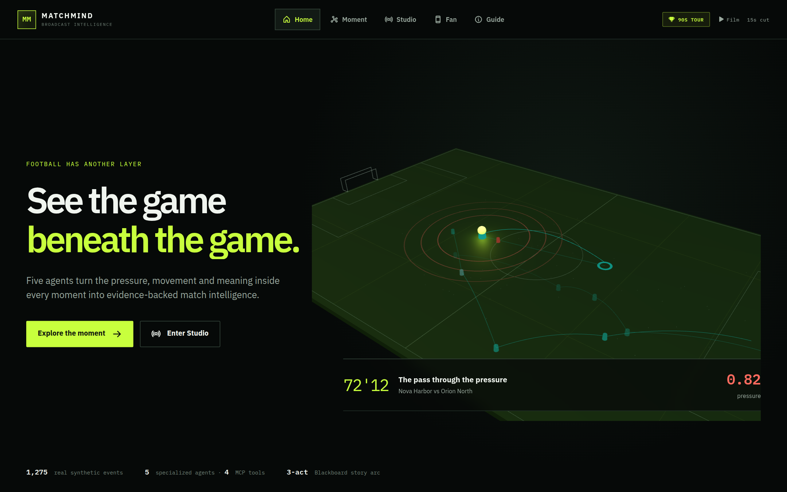
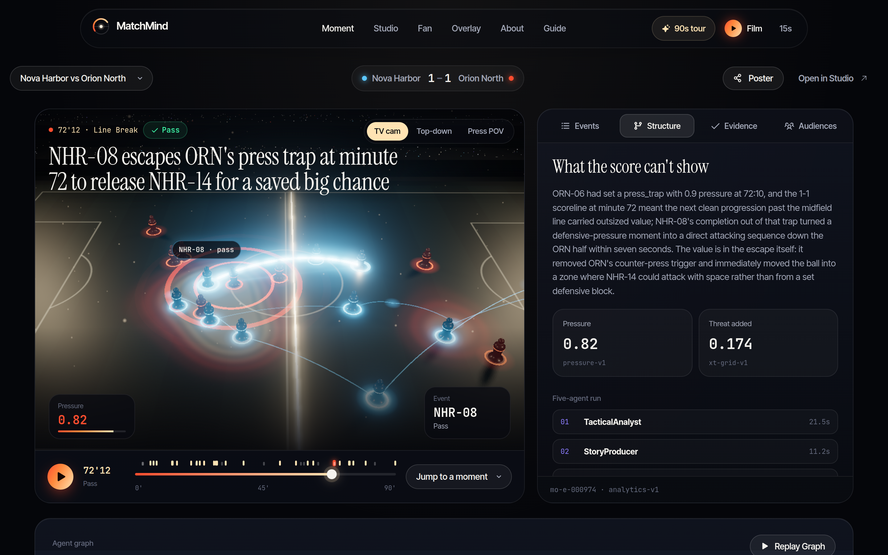
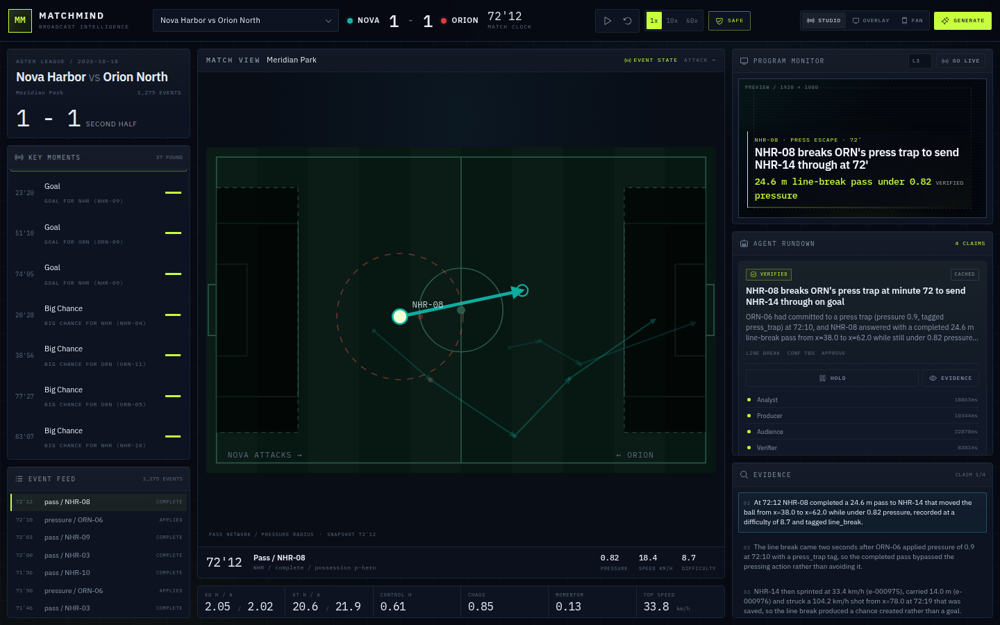
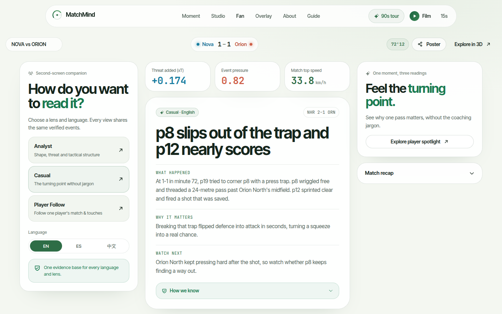

# MatchMind

**See the game beneath the game.**

MatchMind reveals the pressure, movement and tactical structure underneath football. A deterministic analytics engine feeds a five-agent Microsoft Agent Framework workflow, then presents one verified moment as an interactive 3D story, a broadcast control room, a transparent overlay and a personalized fan experience.

> Status: local closed loop live. Five synthetic matches, real `prompt-v3` agent caches, bounded revision, Director airtime planning, MatchBlackboard 3-act narrative arcs, Adversarial Hallucination Gate Lab, Grounded Tactical Copilot, WebSocket replay, and a Moment-centered 3D frontend at `http://localhost:8010`.
> Public static demo: [ruziniuuuuu.github.io/matchmind](https://ruziniuuuuu.github.io/matchmind/) with Home, Moment Focus, Studio, Overlay and Fan.
> Product and architecture: [PLAN.md](./PLAN.md). Completion checklist: [EXECUTION.md](./EXECUTION.md). Judge walkthrough: [docs/JUDGE-GUIDE.md](./docs/JUDGE-GUIDE.md). Pitch deck & script: [docs/PITCH-DECK.md](./docs/PITCH-DECK.md). Marketing launch kit: [docs/LAUNCH-KIT.md](./docs/LAUNCH-KIT.md). Evaluation: [docs/EVALUATION.md](./docs/EVALUATION.md). Submission checklist: [docs/SUBMISSION.md](./docs/SUBMISSION.md).

## Experience

| Surface | Route | Purpose |
|---|---|---|
| **Home** | `/` | One-screen cinematic entry with a real data-driven 3D match scene. |
| **Moment Focus** | `/moment` | Events, Structure, Evidence and Audiences layers, linked by one interactive timeline. |
| **Studio** | `/studio` | Director rundown, program monitor, decision inspector, replay and human approval. |
| **Overlay** | `/overlay` | Transparent 1920x1080 browser source for OBS/vMix. Use `/overlay?bg=1` for a dark preview. |
| **Fan** | `/fan` | Analyst, casual and player readings in English, Spanish and Chinese, with player stats and recap. |
| **About** | `/about` | System graph, verifier and technical evidence. |
| **Guide** | `/guide` | Data, AI explanation and evidence, plus operating instructions. |









## The problem

A match produces 1,200-1,500 events. Broadcasters have seconds to decide what deserves airtime; fans get a scoreline. Existing tools report what happened, not why it mattered, and one feed cannot serve analysts, casual fans and player-focused viewers at the same time.

## The core idea

- **Make the invisible visible.** Real events drive a 3D pitch, pressure rings, passing lines and the Moment timeline.
- **Deterministic facts, probabilistic language.** All football numbers come from the analytics engine. Models explain; they do not invent numbers.
- **Collaboration with a release gate.** FactChecker can request one revision. Producer rewrites, the checker rechecks, and unresolved errors stay off air.
- **Airtime is a decision.** Director ranks moments, suppresses duplicates, selects stoppage windows and explains the rundown. A human keeps final control.
- **One moment, many audiences.** Studio, Overlay and Fan share the same evidence, not separate stories.

## Five agents, one evidence graph

| Agent | Responsibility |
|---|---|
| **TacticalAnalyst** | Finds the pattern and writes grounded claims using MCP analytics. |
| **StoryProducer** | Writes the broadcast cue and performs one bounded revision when requested. |
| **AudienceEditor** | Rewrites the same insight for analyst, casual and player profiles in parallel. |
| **FactChecker** | Challenges claims and cue language. The deterministic verifier remains authoritative. |
| **Director** | Ranks moments, deduplicates, schedules airtime and explains the decision. |

The typed Agent Framework graph is:

```text
prepare -> analyst -> fan-out(producer, audience, checker)
        -> review -> revise once -> recheck -> finalize
        -> Director -> Studio / Overlay / Fan / WebSocket
```

A `revise` verdict enters the bounded loop once. After recheck, warning-only advisory notes can remain visible, but unresolved errors cannot be approved. A deterministic rejection always wins.

## Technology

- **Vite + React + TypeScript** with route-level code splitting
- **Motion** for interface choreography and reduced-motion behavior
- **Three.js** for lazy-loaded, data-driven 3D with SVG fallback
- **Microsoft Agent Framework** for typed graph execution
- **MCP** for analytics tools
- **DeepSeek** through an OpenAI-compatible API; Microsoft Foundry adapter optional
- **SQLite / JSONL** for audit and cached fixtures
- **OpenTelemetry** for traces, latency and cost
- **Remotion + Three Canvas** for the 1080p film and vertical teaser
- **Docker + Render / Fly.io / VPS**, with optional Azure Container Apps deployment

The public demo uses DeepSeek-generated caches. The repository does not claim Azure or Foundry usage unless actually deployed.

## Synthetic data

MatchForge generates five football-realistic matches with fictional clubs and players: events, tracking windows, lineups and evaluation labels. No real footage, data, crests or player likenesses are used. See [data/README.md](./data/README.md) and the [dataset card](./data/dataset-card.md).

## Demo videos

- [90-second MatchMind film](https://ruziniuuuuu.github.io/matchmind/promo.mp4): English narration, original sound design and on-screen captions.
- [15-second vertical teaser](https://ruziniuuuuu.github.io/matchmind/teaser.mp4): an independently composed 9:16 social cut.
- Sidecar subtitles: `promo.en.srt` and `promo.zh.srt` in `web/public/`.

## Public demo

```text
https://ruziniuuuuu.github.io/matchmind/
https://ruziniuuuuu.github.io/matchmind/#/moment?match=ast-2026-1018-nhr-orn
https://ruziniuuuuu.github.io/matchmind/#/studio?match=ast-2026-1018-nhr-orn
https://ruziniuuuuu.github.io/matchmind/#/fan?match=ast-2026-1018-nhr-orn
```

The static snapshot supports all five fixtures, Moment layers, 3D, evidence, rundown, Overlay templates, Fan views and recap without a server. Live generation and WebSocket are intentionally disabled there. Vela vs Kepler is verified but held by Director, demonstrating that approval is not automatic.

## Local development

```bash
make install
cp .env.example .env      # add DEEPSEEK_API_KEY for live generation
make smoke
make data
make web-install
make web-build            # build the frontend
make dev                  # http://localhost:8010
make test
```

The API exposes matches, events, features, moments, insights, recap, config and `WS /ws/matches/{id}`. Local generation uses DeepSeek; `DEMO_MODE=replay` with `ALLOW_LIVE_GENERATION=false` runs the cached closed loop without cloud credentials.

## Video production

```bash
cd video
npm install
npm run sync
uv run --with edge-tts --with numpy python scripts/generate_audio.py
npm run render
```

The main composition is 1920x1080 at 30fps for exactly 90 seconds. The teaser is 1080x1920 at 30fps for exactly 15 seconds. See [video/README.md](./video/README.md).

## Verification

```bash
uv run ruff check .
uv run pytest -q
uv run python scripts/export_static_demo.py
cd web && npm run build && npm run build:static && npm run smoke:static
cd ../video && npx tsc --noEmit
```

The suite includes deterministic analytics, verifier behavior, cue number checks, bounded graph revision, Director airtime rules, WebSocket replay, cached demo mode and browser interaction across desktop, mobile and reduced-motion settings.

## License

Code: MIT, see [LICENSE](./LICENSE).
Data: CC BY 4.0, see [data/LICENSE](./data/LICENSE) and the [dataset card](./data/dataset-card.md).
