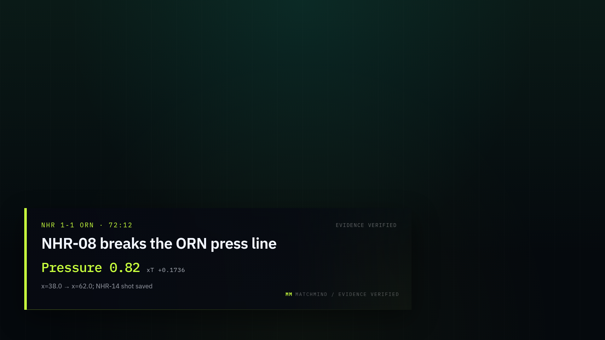
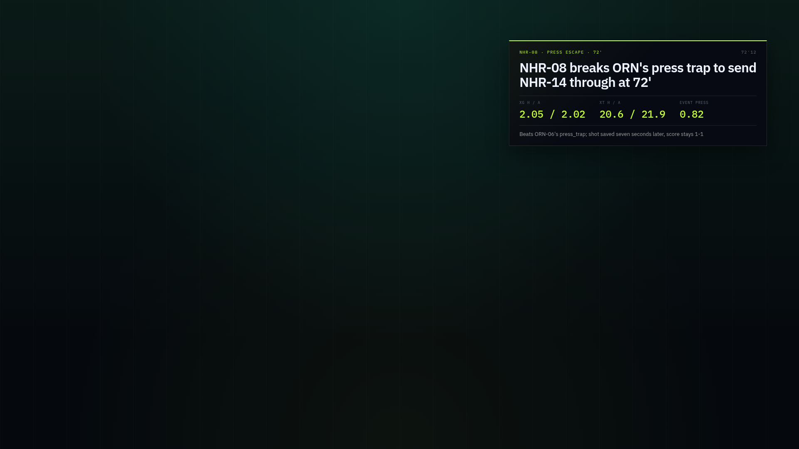
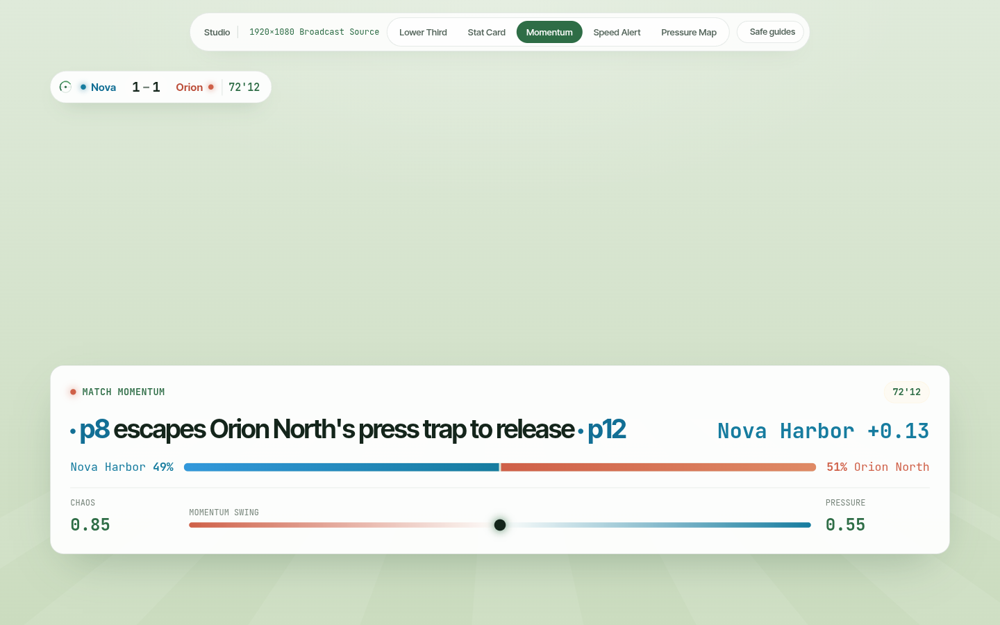
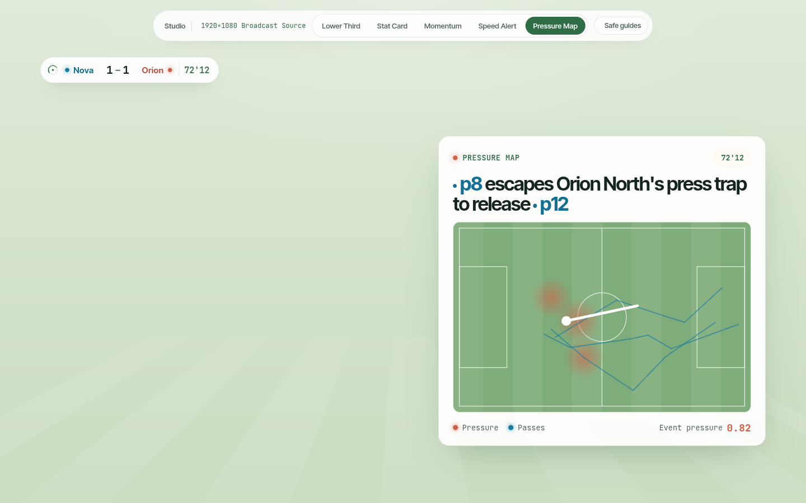

# MatchMind

**Every moment, explained. Every fan, understood.**

MatchMind is a real-time explainability layer for football broadcast. It turns synthetic match events into grounded, timed match intelligence — a deterministic analytics engine feeds a five-agent workflow with a verifier, rendered as a broadcast-ready overlay for the studio and as a personalized second-screen experience for analysts, casual fans, and player-focused viewers.

> Status: local closed loop live — five synthetic matches, deterministic analytics, Agent Framework graph, five cached fixtures, live WebSocket replay, and Studio / Overlay / Fan at `http://localhost:8010`.
> Public static demo: [ruziniuuuuu.github.io/matchmind](https://ruziniuuuuu.github.io/matchmind/) (Studio, five cached fixtures, five overlay templates, Fan).
> Product and architecture: [PLAN.md](./PLAN.md). Completion checklist: [EXECUTION.md](./EXECUTION.md). Judge walkthrough: [docs/JUDGE-GUIDE.md](./docs/JUDGE-GUIDE.md). Evaluation snapshot: [docs/EVALUATION.md](./docs/EVALUATION.md). Performance: [docs/PERFORMANCE.md](./docs/PERFORMANCE.md). Submission checklist: [docs/SUBMISSION.md](./docs/SUBMISSION.md). How to read it: [docs/USER-GUIDE.md](./docs/USER-GUIDE.md).

## Surfaces

| Surface | Route | Purpose |
|---|---|---|
| **Studio** | `/studio` | Broadcast control room: pitch, event feed, agent rundown, evidence, program monitor. |
| **Overlay** | `/overlay` | Transparent 1920x1080 browser source for OBS/vMix. Use `/overlay?bg=1` for a dark preview. Templates: `?template=stat_card`, `momentum`, `speed_alert`, or `pressure_map`. |
| **About** | `/about` | System story: graph, verifier, metrics, and links. |
| **Guide** | `/guide` | Data vs AI explanation vs evidence, and how to drive the Studio. |
| **Fan** | `/fan` | Mobile-first second screen: five fixtures, analyst / casual / player focus, player event log, three languages, and a deterministic recap. |











## The problem

A match produces 1,200–1,500 events. Broadcasters have seconds to decide what deserves airtime; fans get a scoreline. Existing tools report *what happened*, not *why it mattered* — and one feed cannot serve an analyst, a casual fan, and a player-focused viewer at the same time.

## What MatchMind does

One pipeline, five stages:

1. **Ingest** synthetic events and tracking data as they happen.
2. **Interpret** them with a deterministic football state engine: xG, xT, pressure, pass difficulty, control vs. chaos, momentum, rhythm, speed, and distance.
3. **Explain** why a moment matters with specialized agents and an evidence trail.
4. **Render** the insight as a timed broadcast overlay: lower-thirds, stat cards, momentum ribbons, pressure maps, speed alerts.
5. **Personalize** the same moment for analyst, casual, and player-focused audiences in multiple languages.
6. **Recap** the match deterministically: scoreline, goals, cards, key moments, and top speed.

## The agent team

| Agent | Responsibility |
|---|---|
| **TacticalAnalyst** | Finds the pattern and explains why it matters. |
| **StoryProducer** | Writes broadcast language and the overlay specification. |
| **AudienceEditor** | Rewrites for analyst, casual, and player-focused profiles, in parallel. |
| **FactChecker** | Verifies every number and claim against event-level evidence; withholds what it cannot support. |
| **Director** | Prioritizes the rundown, manages airtime, and asks for human approval. |

The workflow is a typed Microsoft Agent Framework graph: prepare → analyst → fan-out(producer, audience, checker) → fan-in(finalize). All football numbers come from a deterministic engine exposed through an MCP server; the models explain, they do not invent.

## Technology stack

- **Vite + React + TypeScript** — Studio, transparent overlay, and fan second screen
- **Microsoft Agent Framework** — graph workflows, shared state, handoffs, checkpointing
- **MCP** — analytics tools exposed to agents
- **DeepSeek** — default model provider via an OpenAI-compatible API (`deepseek-flash`, `deepseek-v4-pro`)
- **Microsoft Foundry** — optional production model adapter
- **SQLite / JSONL** — audit and evidence store for the demo; Cosmos DB adapter optional
- **OpenTelemetry** — agent traces, latency, and cost; Application Insights exporter optional
- **Docker + Render / Fly.io / VPS** — public demo hosting; Azure Container Apps + Bicep optional
- **GitHub Actions + GitHub Copilot** — CI/CD and development

The model layer is provider-agnostic. The public demo runs on DeepSeek; the repository ships a Foundry adapter and Azure Bicep for production deployment. We do not claim Azure or Foundry usage unless it is actually deployed.

## Synthetic data

MatchForge generates football-realistic synthetic matches with fictional clubs and players: events, tracking windows, lineups, and ground-truth labels for evaluation. Five narrative matches live in [`data/demo/`](./data/demo); see the [data README](./data/README.md) and [dataset card](./data/dataset-card.md). No real match footage, data, club crests, or player likenesses are used.

## Repository layout

```text
src/matchmind/   # API, analytics, agents, MatchForge, MCP, store, schemas
web/             # Studio, overlay, and fan experiences
data/            # Synthetic matches, labels, dataset card
infra/           # Docker, optional Bicep/azd
tests/           # Unit, contract, and evaluation tests
docs/            # Architecture, data card, demo script
```

## Demo video

- [Two-minute MatchMind promo](https://ruziniuuuuu.github.io/matchmind/promo.mp4): the problem, data layer, five-agent graph, verifier, Studio, overlays, and Fan.

## Public demo

The GitHub Pages build is a static snapshot: five fixtures, overlay templates,
Fan views, recap, replay, and evidence all work without a server. Live generation
and the WebSocket feed are intentionally disabled there. It is deployed from this
repository, not a separate demo repository.

```
https://ruziniuuuuu.github.io/matchmind/
https://ruziniuuuuu.github.io/matchmind/#/studio?match=ast-2026-1025-vel-kep
https://ruziniuuuuu.github.io/matchmind/#/about
https://ruziniuuuuu.github.io/matchmind/#/overlay?bg=1&template=stat_card
https://ruziniuuuuu.github.io/matchmind/#/fan?match=ast-2026-1025-vel-kep
```

The static snapshot is rebuilt by `.github/workflows/pages.yml` on each push.
The local app below keeps the full live pipeline, WebSocket replay, and Generate.

## Local development

Local workflow:

```bash
make install
cp .env.example .env      # add DEEPSEEK_API_KEY
make smoke                # raw API + Agent Framework check
make data                 # generate five synthetic matches
make web-install
make web-build            # build Studio / Overlay / Fan
make dev                  # http://localhost:8010/studio
make test
```

Local dev currently runs at `http://localhost:8010` (port 8000 is used by Caddy). The API exposes `/api/matches`, `/api/matches/{id}`, `/api/matches/{id}/events`, `/api/matches/{id}/features`, `/api/matches/{id}/moments`, `POST /api/matches/{id}/insights` (five-agent pipeline, cached for the demo), `/api/config`, `/api/matches/{id}/recap` (deterministic match recap), and `WS /ws/matches/{id}` (live replay with cached cue delivery). The public demo requires a tunnel or host; it will run in `DEMO_MODE=replay` without cloud credentials so reviewers can test the full experience. Live AI mode uses DeepSeek; a Foundry adapter is included for Azure deployments.

## Deploy

The repository includes `render.yaml`, `fly.toml`, and a verified multi-stage Dockerfile
that builds the Vite frontend and the Python app into one container. For a
cached-only public demo, set:

```env
DEMO_MODE=replay
ALLOW_LIVE_GENERATION=false
```

See [docs/DEPLOY.md](./docs/DEPLOY.md) for Render, Fly.io, and Azure notes.

## License

Code: MIT, see [LICENSE](./LICENSE).
Data: CC BY 4.0, see [data/LICENSE](./data/LICENSE) and the
[dataset card](./data/dataset-card.md).
