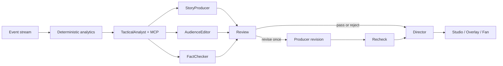

# MatchMind judge guide

**See the game beneath the game.** MatchMind turns synthetic football events into visible tactical structure, verified explanations and audience-specific match intelligence.

## Fast path

1. [Watch the 90-second film](https://ruziniuuuuu.github.io/matchmind/promo.mp4). A [15-second vertical teaser](https://ruziniuuuuu.github.io/matchmind/teaser.mp4) is also available.
2. Open the [immersive Home](https://ruziniuuuuu.github.io/matchmind/) or click **90s Tour** in the top navigation for an interactive 5-step walkthrough.
3. Choose **Explore the moment**. Switch 3D camera presets (**TV Cam / Top-Down xT / Press POV**), scrub the timeline, and switch **Events / Structure / Evidence / Audiences**.
4. Scroll to the **Microsoft Agent Framework Graph** (`Replay Graph`), step through the **3-Act MatchBlackboard Narrative Arc**, ask a question in **Tactical Copilot**, and test the **Hallucination Gate Lab** (`Trap #1: 33.4 vs 33.8 km/h` and `Trap #2: Unverified Cue Number 94.6%`). Click **Poster** to download a vector SVG share card.
5. Open **Studio**. Inspect Director's ranked rundown, suggested airtime, live agent topology, and Hallucination Lab. Use **Hold**, then **Approve**, and watch the program monitor change. Select Vela vs Kepler to override a verified Director Hold with a human Approve.
6. Switch **L3 / STAT / MOM / SPD / MAP**. Open `/overlay` without `bg=1` for the transparent OBS source. Director-held cues stay off air unless Studio's Full screen link carries `approval=approved`.
7. Open **Fan**, switch Analyst / Casual / Player and EN / ES / 中文. Open the deterministic match recap.

Local equivalents use `http://localhost:8010/moment`, `/studio`, `/overlay` and `/fan`.

## The 72:12 hero moment

Nova Harbor vs Orion North is the default fixture. NHR-08 releases NHR-14 with a 24.6 m pass under 0.82 pressure, adding 0.1736 xT. The event, metrics, agent claims and broadcast cue all come from the same cached `prompt-v3` run.

The public static demo never needs a model key. Live generation and WebSocket replay remain available locally.

## What to look at

### Home and Moment Focus

- **Real 3D**: a lazy-loaded Three.js pitch with event coordinates, passing lines and pressure rings.
- **Interactive anatomy**: playback, scrubbing and key-moment jumps change the same shared match state.
- **Four layers**: raw events, tactical structure, claim evidence and audience readings.
- **Real trace**: agent names, revision steps and fallback states come from the API response.
- **Accessible fallbacks**: reduced-motion users get the real-data SVG scene; all controls remain available.

### Studio

- **Director's rundown**: ranked candidates, reasons, duplicate suppression and scheduled airtime.
- **Program monitor**: five transparent overlay templates with safe-area guides.
- **Human control**: Hold removes the cue; Approve restores it; Kill keeps it off air.
- **Live replay**: the local app consumes a WebSocket stream, not polling.

### Multi-agent collaboration



- The deterministic verifier checks candidate claims and actual cue numbers.
- `revise` enters the loop once. Unresolved errors remain held.
- Warning-only model notes remain advisory after recheck; they cannot override deterministic facts.
- Director ranks within deterministic candidate and airtime constraints. It cannot approve failed verification.

### Evidence you can verify

- **5/5** cached fixtures pass verification.
- **4/5** are approved for air. Vela vs Kepler is deliberately held by Director.
- **45** fan cards and **25** claims across five fixtures.
- **3** real bounded revision loops in committed `prompt-v3` traces.
- **39** Python tests, plus static browser smoke on desktop, mobile and reduced motion.

See [EVALUATION.md](./EVALUATION.md) for per-fixture results.

## Verify it yourself

```bash
uv run pytest -q
uv run ruff check .
uv run python scripts/export_static_demo.py
cd web && npm run build && npm run build:static && npm run smoke:static
cd ../video && npx tsc --noEmit
```

## Where the score comes from

| Criterion | Evidence |
|---|---|
| Technological implementation | Deterministic analytics, MCP, Agent Framework revision graph, Three.js, WebSocket, tests and packaging |
| Agentic design | Five typed roles, parallel fan-out, bounded feedback, advisory review, Director planning and real trace |
| Real-world impact | Broadcast rundown, transparent overlays, human approval and personalized second screen |
| UX / presentation | Cinematic Home, interactive 3D Moment anatomy, energetic motion, responsive Fan and two produced films |
| Category fit | Best Multi-Agent System: collaboration, correction and airtime decisions with evidence, not a chat wrapper |
