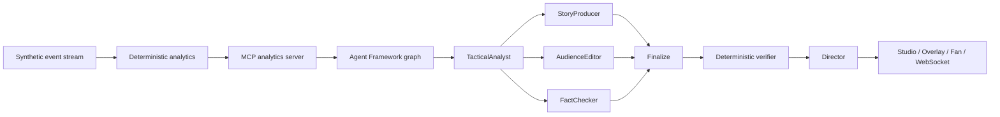

# MatchMind judge guide

MatchMind is a real-time explainability layer for football broadcast. It turns
synthetic event data into grounded, timed match intelligence and gives three
audiences different views of the same verified moment.

## Quick path

[Watch the two-minute promo](https://ruziniuuuuu.github.io/matchmind/promo.mp4).

Public static demo: <https://ruziniuuuuu.github.io/matchmind/#/studio>.
Operator guide: <https://ruziniuuuuu.github.io/matchmind/#/guide>.
System story: <https://ruziniuuuuu.github.io/matchmind/#/about>.
It contains all five fixtures and overlay templates; live generation and the
WebSocket feed are available in the local app.

1. Open `https://ruziniuuuuu.github.io/matchmind/#/studio?match=ast-2026-1025-vel-kep` or `http://localhost:8010/studio?match=ast-2026-1025-vel-kep`.
2. The hero match is preselected: Nova Harbor vs Orion North, 72:12, 1-1.
   Use the match selector to switch all five fixtures; each has a precomputed
   insight. One fixture shows an advisory FactChecker fallback in its agent trace
   while the deterministic gate still passes.
3. Read the **key moment**, then the **agent rundown** and **evidence drawer**.
4. Press **Go live** to watch events arrive over WebSocket; the cached insight
   and cue are delivered when the stream reaches the hero moment.
5. Use the program-monitor selector to switch **L3 / STAT / MOM / SPD / MAP**.
6. Open `/overlay?bg=1` for the full-screen preview, or `/overlay` for the
   transparent OBS source. Add `?template=stat_card`, `momentum`, `speed_alert`,
   or `pressure_map` for the other templates.
7. Open `/fan` and switch the fixture, analyst / casual / player, English / Spanish / Chinese.
   Scroll to the deterministic match recap.

## What to look at

### Studio

- **Control room layout**: match selector, score and clock, event feed, key
  moments, pitch trail, program monitor, agent rundown, evidence, stat row.
- **Evidence first**: every claim shows event IDs and metric calculations.
  Contradictory model claims are rejected by the deterministic verifier.
- **Agent trace**: TacticalAnalyst, StoryProducer, AudienceEditor, FactChecker,
  Director, each with status and latency.
- **Approval is real**: Hold removes the cue from the program monitor; Approve
  puts it back on air.
- **Live feed**: the same UI consumes a WebSocket replay rather than polling.

### Overlay

Five transparent templates share the verified cue payload:

| Template | Query | What it shows |
|---|---|---|
| Lower third | `/overlay` | Headline, stat, subline, evidence mark |
| Stat card | `?template=stat_card` | xG, xT, event pressure |
| Momentum | `?template=momentum` | Control share, chaos, pressure |
| Speed alert | `?template=speed_alert` | Match top speed and event count |
| Pressure map | `?template=pressure_map` | Recent pressure and pass locations |

Add `bg=1` for a dark preview. Without it the background is transparent.

### Fan

- Analyst, casual, and player-focused cards for the same moment.
- Player focus selector with a deterministic event log: passes, completion, shots,
  and top speed for any player in the match.
- Three languages, with the same evidence underneath.
- A deterministic match recap with scoreline, goals, cards, key moments, and
  top speed.
- Mobile-first layout, readable without the control-room chrome.

## Architecture



- **Graph**: `prepare -> analyst -> fan-out(producer, audience, checker) ->
  fan-in(finalize) -> director`, built with Microsoft Agent Framework
  `WorkflowBuilder`. The sequential pipeline remains as a fallback.
- **Grounding**: the models never compute football numbers. xG, xT, pressure,
  pass difficulty, control, chaos, momentum, and speed come from the deterministic
  engine. The MCP server exposes the same evidence to agents.
- **Verification**: the deterministic verifier is the release gate. The LLM
  FactChecker is advisory. A claim that cannot be supported is withheld rather
  than softened.
- **Delivery**: one container serves the API, WebSocket, and built SPA. Cached
  insights keep the public demo fast and prevent visitors from spending the
  owner's model budget.

## Where the score comes from

| Criterion | Evidence |
|---|---|
| Technological implementation | Deterministic analytics, MCP, Agent Framework graph, WebSocket replay, verifier gate, tests, Docker/Render/Fly packaging |
| Agentic design | Five typed roles, concurrent fan-out/fan-in, shared graph state, fallbacks, trace, advisory FactChecker |
| Real-world impact | Broadcast control room, transparent overlays, fan second screen, match recap, approval workflow |
| UX / presentation | Broadcast-grade visual system, evidence drawer, safe-area guides, five overlay templates, mobile Fan |
| Category fit | Best Multi-Agent System: a working five-agent workflow with grounded evidence, not a chat wrapper |

## Verify it yourself

```bash
uv run pytest -q
uv run ruff check .
cd web && npm run build
```

The suite covers matchforge determinism, analytics, verifier behavior, the
Agent Framework graph, WebSocket replay, recap generation, and cached-only demo
mode.
