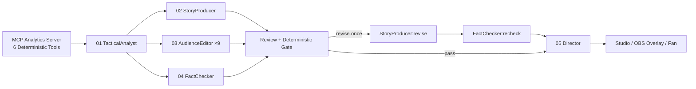

# MatchMind — Hackathon Finale Pitch Deck & 90-Second Live Script

> **Category**: Best Multi-Agent System  
> **Tagline**: *See the game beneath the game.*

---

## Part 1: 8-Slide Finale Deck Structure

### Slide 1 — Title & Vision
- **Headline**: MatchMind — See the game beneath the game.
- **Subheadline**: Real-time match intelligence for broadcast and fans, with every claim checked against event-level evidence.
- **Visual**: Live 3D parabolic pass arc at 72:12 (`NHR-08` → `NHR-14` under `0.82` pressure, `+0.174 xT`).

### Slide 2 — The Broadcast & Fan Problem
- **1,200–1,500 events** happen in a single football match.
- **Broadcasters** have 3–5 seconds to decide what deserves airtime and why.
- **Fans** get a raw scoreline or generic commentary; one feed cannot serve a tactical analyst, a casual viewer, and a player-focused fan across languages simultaneously.
- **Why Naive LLMs Fail**: Directly prompting an LLM on match streams produces hallucinated numbers and false superlatives — unacceptable in live broadcast.

### Slide 3 — Core Architectural Principle
- **Deterministic Facts, Probabilistic Language**:
  - **Deterministic Engine**: Computes xG (`xg-v1`), 12×8 Expected Threat (`xt-v1`), pressure index, pass difficulty, momentum change points, and sprint peaks.
  - **Probabilistic Agents**: Explain *why* the moment matters, write timed broadcast cues, personalize for 9 audience×language profiles, and plan the rundown — without ever inventing a number.

### Slide 4 — Behind the Scenes: Evidence Infrastructure

- **Optional technical deep dive**: Five specialized agents remain infrastructure, not a concept viewers must learn. They separate analysis, writing, localization, checking and scheduling so unsupported claims stay off air.

### Slide 5 — The Hallucination Gate (33.4 vs 33.8 km/h)
- **Scenario**: At 72:12, `NHR-14` sprints at `33.4 km/h` after a line-breaking pass. An agent claims *"fastest sprint of the match"*.
- **Interception**: `FactChecker` + `get_pressure_comparison` MCP tool + `verify_deterministic` cross-check the `MatchBlackboard` and find event `e-000419` in the 31st minute (`33.8 km/h`).
- **Outcome**: Flagged `unsupported_superlative` (`error`) — blocked before air, rewritten into a verified release.

### Slide 6 — MatchBlackboard & 3-Act Narrative Memory
- Agents don't just analyze isolated snapshots; `MatchBlackboard` links **Act I (31' Sprint Catalyst)** → **Act II (72' Press-Trap Line Break)** → **Act III (74' Decisive Surge)** while suppressing duplicate claims within a 60-second window.

### Slide 7 — One Evidence Bundle, Four Production Surfaces
1. **3D Moment Focus**: Parabolic Bezier trajectories, xT grid, TV/Tactical/Press POV cameras, and Grounded Tactical Copilot.
2. **Broadcast Studio**: Director rundown, 15s lower-third gap, stoppage scheduling, and human Approve/Hold/Kill override.
3. **1920×1080 OBS Overlay**: Transparent browser source (`L3 / STAT / MOM / SPD / MAP`) with broadcast safe areas.
4. **Fan Second Screen**: Analyst / Casual / Player Follow × English / Spanish / 中文, plus one-click SVG Tactical Poster export.

### Slide 8 — Verification & Engineering Rigor
- **5/5** synthetic matches (6,281 events, 30 ground-truth labels) verified.
- **49** automated Python tests + Playwright desktop/mobile/reduced-motion browser smoke tests.
- **Zero-key static demo** live on GitHub Pages + full Docker / FastAPI / WebSocket / DeepSeek local closed loop.

---

## Part 2: 90-Second Live Demo Script (Word-for-Word)

- **0:00–0:15 (Home & 3D Pitch)**:
  *"Scores tell you what happened; MatchMind shows you why. On our Home screen, this 3D pitch isn't a video — it's driven by 1,275 synthetic events from Nova Harbor vs Orion North."*
- **0:15–0:35 (Moment Focus & Blackboard Story Arc)**:
  *"Click **Explore the moment**. At 72:12, NHR-08 threads a 24.6-meter pass through 0.82 pressure, adding +0.174 Expected Threat. We can switch 3D cameras from TV Cam to Top-Down xT or Press POV, and step across the 3-act MatchBlackboard Story Arc."*
- **0:35–0:55 (Evidence & Hallucination Gate Lab)**:
  *"Behind the scenes, five agents verify every claim. In the **Hallucination Gate Lab**, a draft claims 33.4 km/h is the fastest sprint. The evidence shows 33.8 km/h earlier in the match, so the claim is blocked before air. Viewers get trusted insight without needing to understand the infrastructure."*
- **0:55–1:15 (Studio Rundown, Human Override & OBS Overlay)**:
  *"In **Studio**, Director ranks moments, enforces a 60-second dedupe window, and schedules the cue for the next stoppage. On Vela vs Kepler, Director holds the cue — and as a human producer, I can click **Approve** to override and push it live to our 1920×1080 transparent OBS overlay."*
- **1:15–1:30 (Fan Second Screen & Share Poster)**:
  *"Finally, in **Fan**, that exact same verified evidence bundle powers Analyst, Casual, and Player Follow cards in English, Spanish, and Chinese — and exports a vector tactical poster in one click. See the game beneath the game."*

---

## Part 3: Judge Q&A Cheat Sheet

1. **Q: Why use 5 agents instead of a single structured LLM call?**
   - **A**: Three reasons: (1) *Self-auditing bias* — a model that generates a narrative rarely catches its own numeric hallucinations; separating `TacticalAnalyst`/`StoryProducer` from `FactChecker` + deterministic `verify_cue` creates a true release gate. (2) *Latency via parallel fan-out* — `StoryProducer`, `AudienceEditor` (9 profile×language variants), and `FactChecker` execute concurrently after `TacticalAnalyst`. (3) *Bounded revision* — only `StoryProducer` re-runs on a `revise` verdict (`max=1`), keeping token cost and latency predictable.
2. **Q: How do you guarantee zero hallucinated stats on broadcast television?**
   - **A**: Every metric (`xG`, `xT`, `pressure`, `speed_kmh`) is computed deterministically in Python (`src/matchmind/analytics/engine.py`) with a formula version tag. Before any `OverlayCue` can be approved, `verify_deterministic()` checks every `MetricRef` value and `verify_cue()` regex-extracts every float/integer from the broadcast text to verify it matches the grounded candidate within `±0.011`.
3. **Q: Why synthetic data (`MatchForge`) instead of real Premier League data?**
   - **A**: Commercial tracking/event feeds (Opta/StatsBomb live) are proprietary and cannot be redistributed in an open-source MIT repository. `MatchForge` generates 5 seeded, reproducible matches (6,281 events) that pass strict football realism bounds while allowing anyone to run the full stack from a clean clone with zero licensing barriers.
